# 通用异构分布式计算仿真框架：工程实现规格

版本：1.0 · 日期：2026-11-13 · 状态：研究原型设计，可据此分阶段实现

> **目标：用同一组资源、数据和执行语义，回答一个 workload 放在给定异构系统上如何执行、为何耗时，以及时间、空间和通信之间存在什么权衡。**
>
> 核心结构为 **Hardware Resource Graph + Workload DAG + Placement + Scheduler + Discrete-Event Simulation Engine**。Transformer/LLM 是第一个 workload 插件；核心引擎不认识 token、attention、TP 或 PP，也不依赖特定推理框架。

本文中的数值 profile 均为**合成示例**，不代表任何真实型号的性能。Python 代码为接口设计与可复制的数据模型片段；算法段为伪代码，并非已经交付完整 simulator。建议 Python 3.11+；实际项目应锁定并记录依赖版本。外部依据链接随相关内容给出；未标为文献结论的架构与模型选择均是本文提出的设计。

## 阅读导航

| 关注点 | 章节 |
|---|---|
| 抽象、边界和硬件建模 | 1–5 |
| workload、映射与执行语义 | 6–10 |
| Python 架构、配置、算法与手算例子 | 11–14 |
| 指标、验证和随机网络 | 15–17 |
| LLM 插件、优化、下界与时间空间权衡 | 18–20 |
| MVP 路线、验收、决策和资料 | 21–24 |

## 1. 目标、边界与模型层级

### 1.1 必须支持的研究问题

1. CPU、不同 GPU、UMA 机器以及不同互连混用时，放置和调度如何影响总时间？
2. 同一个数据放在 RAM、VRAM、UMA 或远端内存，容量和搬运开销如何变化？
3. 理论峰值、算子实测效率、内存带宽与网络争用分别造成多少影响？
4. 给定空间预算，保留、释放、offload、重新计算何时有利？
5. 哪些结果是某个启发式策略的表现，哪些是可证明的下界？

### 1.2 初期范围与明确边界

初期以**算子/数据块级、流级、离散事件仿真**为粒度。不模拟指令流水线、缓存行一致性、TCP 每个包、无线 MAC 或完整操作系统。NUMA、缓存和页迁移可以作为显式资源/活动逐步加入。

模型按能力分层，实验必须记录所用层级：

| 层级 | 计算模型 | 传输模型 | 可回答的问题 |
|---|---|---|---|
| A：deterministic MVP | 非抢占 kernel；固定时长；保守的独占资源预约 | 固定路由；端到端带宽预约 | 依赖、容量、placement、基础 contention |
| B：fluid contention | 可选分阶段或流体服务 | 多约束 weighted max-min；速率随竞争变化 | UMA/链路共享、重叠与带宽瓶颈 |
| C：time-varying | 容量轨迹、背景负载 | 分段常数网络轨迹 | 突发拥塞、带宽下降、时间相关性 |
| D：stochastic | 经校准的随机扰动 | 条件分布、相关随机过程 | 尾延迟、稳健性、风险目标 |

A 不应宣传为真实硬件的精确预测；B 也不自动等价于 TCP 或 GPU kernel 的真实共享行为。所有精度声明都依赖校准与验证。

### 1.3 核心契约

- **静态描述与动态状态分离**：硬件图和 workload 定义可复用；每次仿真创建独立运行状态。
- **物理预算只有一个所有者**：图可以有多条访问路径，同一个容量/带宽预算不得重复创建。
- **所有时间来自仿真时钟**：主机运行耗时仅用于评估 simulator 本身的速度。
- **拓扑可达不等于操作合法**：能在图上走通，不代表支持 CPU load、GPU P2P 或 RDMA。
- **逻辑完成不等于数据可用**：producer 完成之后，consumer 还可能等待复制、迁移或同步。
- **先保证守恒与可重放，再增加精度**：活动、资源、数据副本都必须能在 trace 中追溯。

## 2. 总体架构与数学对象



硬件图：

\[
G_H=(V_H,E_H,\mathcal R,\Theta_H),
\quad V_H=V_C\cup V_M\cup V_N\cup V_S\cup V_D.
\]

其中 $C$ 为 compute，$M$ 为 memory，$N$ 为 NIC，$S$ 为 switch/router，$D$ 为 DMA/copy engine；$E_H$ 是可寻址的有向多重边；$\mathcal R$ 是物理容量与服务能力约束集合；$\Theta_H$ 为 profile、访问权限和校准数据。

逻辑 workload：

\[
G_W=(V_O,V_T,E_W),
\]

建议内部采用 **operator–tensor 二部有向图**：$o_i\to x_j\to o_k$。producer 到 tensor、tensor 到多个 consumers；同一个 tensor 不因扇出而重复占空间。外部也可以输入 operator DAG 加边上的 tensor ID，再规范化为二部图。

放置方案 $\phi$ 和调度策略 $\sigma$ 经 lowering 生成执行活动图：

\[
G_X=\operatorname{lower}(G_W,G_H,\phi),
\qquad \operatorname{simulate}(G_X,G_H,\sigma,\omega)\to\text{RunResult}.
\]

$\omega$ 表示环境轨迹/随机场景。$G_X$ 包括 compute、transfer、allocation、同步、必要的转换活动。逻辑图、执行图、实际事件 trace 是三个不同对象。

| 对象 | 生命周期 | 主要职责 |
|---|---|---|
| HardwareSpec / WorkloadSpec | 不变 | 可序列化、校验、哈希 |
| PlacementPlan / ExecutionPlan | 一次候选方案 | 决定算子位置、初始副本、路径和 lowering |
| SimulationState | 一次运行 | 时钟、活动进度、占用、副本、等待队列 |
| Scheduler / Arbiter | 可替换策略 | 分别选择启动什么、分配多少服务率 |
| Trace / RunResult | 运行输出 | 重放、解释、比较、优化反馈 |

## 3. Hardware Resource Graph

### 3.1 为什么不能以机器作为最小单位

机器只用作 `host_id`、故障域、能耗/成本归属或部署边界。一个 host 内可能有多个 NUMA domain、GPU、内存控制器和 NIC；同 host 也可能发生昂贵复制。跨 host 的 RDMA 又可能绕过 CPU。

NetworkX 的 `MultiDiGraph` 支持有向平行边及其属性，适合表达两资源之间的 PCIe、NVLink 或不同轨道；物理共享预算另存于 `ResourceSpec`，不依赖边对象数量。[NetworkX MultiDiGraph 文档](https://networkx.org/documentation/stable/reference/classes/multidigraph.html)

### 3.2 节点规范

| kind | 必需属性 | 可选属性 / 说明 |
|---|---|---|
| compute | id、host_id、device_type、支持的 op/dtype、执行槽资源 ID | shape/layout 限制、profile 表、可访问内存、launch latency、抢占能力 |
| memory | id、physical_pool_id、capacity resource ID、tier | RAM/VRAM/HBM/SRAM/UMA、地址域、页大小、分配对齐、可寻址设备 |
| nic | id、host_id、tx/rx 服务资源、连接端口 | RDMA、GPUDirect、queue 数、CPU 开销、协议卸载能力 |
| switch | id、port IDs、端口/内部 fabric 约束 | 非阻塞或过订阅、共享上联、路由限制 |
| dma | id、slots resource ID、支持的源/目标类型 | H2D/D2H 是否独立、P2P、copy setup latency |

不要定义唯一的 `compute_power=100 TFLOPS`。必须区分 `op_family × input_dtype × accumulate_dtype × shape/layout × algorithm` 的有效性能。INT8 用 operations/s，浮点用 FLOP/s；不能将两者直接相加得到总算力。

计算设备示例：

\[
c=(K_c,\mathcal D_c,\mathcal A_c,P_c(\text{signature}),n_c,L_c^{launch}).
\]

$K_c$ 为支持的算子族，$\mathcal A_c$ 为访问能力；$P_c$ 是性能函数而非单个常数，$n_c$ 是执行槽上限。MVP 默认一个 GPU 只有一个非抢占 kernel 槽；CPU 可先按 NUMA domain 建单个执行资源，随后再细化为核组/线程预算。

### 3.3 边与物理资源约束分离

一条 `ChannelSpec` 至少包含：

```text
id, src, dst, kind, allowed_operations,
nominal_payload_Bps, propagation_s, setup_s,
resource_demands, pair_id, sharing_policy, trace_ref
```

`resource_demands` 指向真正的共享资源。例如两条 GPU→NIC 路径虽然 edge ID 不同，都消耗 `pcie_root_bw`。交换机每端口都快，并不表示总 fabric 或上联无限。

| 资源类别 | 单位 | 示例 |
|---|---|---|
| storage | byte | RAM/VRAM/UMA 容量 |
| rate | byte/s、FLOP/s、op/s | HBM 控制器、NIC tx、fabric |
| renewable slots | count | GPU kernel、DMA、CPU 核组、NIC queue |

slot 是活动期间的预约；rate 是活动执行时的服务；storage 从分配到释放持续占用。这三种约束不能混用同一个 `busy` 布尔量。

对于相同物理容量的不同虚拟视图，解析后必须指向同一 `physical_pool_id`。缓存若显式建模，是另一个有容量和搬运规则的 pool；否则只通过有效 IO/profile 体现，不能假装免费无限缓存。

### 3.4 路由与访问语义

route 保存 `tuple[channel_id, ...]`，不能只保存节点序列，否则平行链路会歧义。路径求解先构造**操作类型专属的访问图**，再查找候选路径。

建议 operation 类型：`local_load`、`local_store`、`copy`、`p2p_copy`、`rdma_read`、`rdma_write`。每类有不同权限和服务资源。

不允许将 CPU→RAM→GPU 任意图路径理解为 CPU 可以直接读 GPU HBM。若 P2P 不支持，lowering 必须生成 GPU HBM→host RAM→remote host RAM→remote GPU HBM 的 staging 活动，并计 staging 空间。

MVP 使用预定义路由；下一阶段按消息大小最小化近似 $L_{path}+S/B_{bottleneck}$，随后加入拥塞价格。NetworkX 普通最短路无法自动求解共享带宽下的多流路由问题。

## 4. Memory hierarchy 与统一数据移动模型



图中的连线只展示可达关系；实现中需要带方向、权限及共享资源引用的 channel。

### 4.1 四个正交概念

1. **数据对象**：逻辑 tensor/data block，包括 shape、dtype、版本。
2. **物理副本**：数据某个版本在某 pool 中的一次分配。
3. **访问能力**：哪个 compute/NIC 能通过何种路径访问副本。
4. **服务预算**：访问经过的控制器、fabric、DMA 和链路。

HBM 是存储技术，VRAM 是设备内存角色；一个 GPU memory pool 可以同时 `role=VRAM, technology=HBM`。PCIe/NVLink 是通道；不能与 RAM/HBM 一起列为可存储 tensor 的 tier。

### 4.2 discrete memory

- CPU kernel 主要从 RAM 读写，GPU kernel 从 VRAM/HBM 读写。
- RAM→VRAM 是一次显式 copy，至少消耗 RAM read、PCIe、VRAM write 和 DMA 约束。
- GPU 读取已驻留权重仍有 HBM IO；“已在显存”不等于“没有内存读取时间”。
- 若 kernel profile 已包含内部 HBM IO，不得再把同一批 IO 作为前置 transfer 重复收费。
- NVLink 是否支持 peer load、P2P copy、coherent access 取决于 profile 能力；存在 NVLink 边本身不提供这些语义。

### 4.3 UMA

UMA 采用一个物理 pool，共享 CPU/GPU 容量。两个 device 各有访问 channel，但引用相同的 `uma_bw` 服务预算。

共享地址映射允许时，CPU→GPU 的 producer-consumer 交接可不复制整个 tensor；仍需满足同步、可见性与读写版本约束。GPU 对数据的实际读取继续消耗 UMA 带宽。

UMA 不自动承诺所有访问完全一致、所有分配零拷贝。profile 应包含 `shared_addressable`、`visibility_policy`、可能的 `ownership_transition_s`。若统一虚拟内存实际执行页迁移，则建多个物理 pool 和 `MIGRATE_PAGE` 活动，不能用单 pool UMA 替代。

### 4.4 容量、生命周期和别名

任意 pool $m$、时刻 $t$ 必须满足：

\[
\sum_{a\in Alloc(m,t)}\operatorname{aligned\_bytes}(a)
+M_m^{workspace}(t)+M_m^{system}(t)\le M_m^{capacity}.
\]

分配状态：`RESERVED → WRITING → VALID → RETIRED → FREED`。规则：

- 在 compute/transfer 启动前，原子预约全部输出和 workspace；输入必须有效且被 pin。
- transfer 目标在传输前计空间，完成后才变为 VALID。源在传输完成前不可释放；后期可用更精细的源端完成事件提前解除 pin。
- 消费者 compute **完成**后减少输入读引用；仅在 consumer 启动时减引用会造成 use-after-free。
- 多消费者共享一个副本；多个 pool 的复制是多个 allocation，各计容量。
- pinned weights、请求状态、最终输出有显式保留策略。终点 `output_contract` 决定输出须位于哪个 pool，是否包含回传时间。
- view/alias 指向同一 allocation 与 byte range；MVP 禁止可变重叠写，后续用版本与读写冲突管理。
- workspace 在 compute 完成时释放；输出在最后读取/返回完成后释放。

所有空间预约采用“全部成功或全部回滚”，不能先持有一半输出缓冲再无限等待另一半。这样消除部分持有死锁，但不保证调度总可行：保留过多缓存仍可能造成无可用空间，需要策略触发 eviction/offload，或返回带原因的不可行结果。

### 4.5 数据搬运的统一描述

\[
\operatorname{Move}(x,m_s,m_d,p,\text{mode},\text{version}).
\]

source/target、路由、有效字节数、协议开销、压缩/转换活动均显式记录。压缩不是免费减少 $S$：必须有压缩、解压 compute 及 workspace。dtype cast 同理。

本地内存 IO、PCIe copy、NVLink copy 和跨机网络均使用相同的资源约束机制；各自可采用不同 latency、服务阶段和访问语义。这种统一只统一建模接口，不宣称它们有相同协议行为。

## 5. Network topology、时间变化与 contention

### 5.1 无争用单流基线

对大小 $S$ byte、固定端到端路径：

\[
T_{move}=L_{setup}+\sum_{e\in p}L_e+\frac{S_{wire}}{B_{path}},
\qquad B_{path}=\min_{r\in R(p)}\frac{C_r}{a_{fr}}.
\]

$S_{wire}$ 包括明确建模的协议扩张，或采用已校准 payload bandwidth；**两者选一种，避免双重扣除**。$a_{fr}$ 是每 byte 端到端有效载荷在资源 $r$ 上产生的 byte 数，如同一控制器同时承担源读和目标写时可能为 2。

这里采用“单次启动/传播延迟 + 端到端 fluid 流水传输”。store-and-forward 模式则逐跳传完整消息，各跳有自己的活动与缓冲容量；不能把所有跳的 $S/B$ 相加后仍称为 cut-through。

### 5.2 duplex 与交换机

- full duplex：两个方向有独立 rate resource；若同时共享其他 fabric，另加公共约束。
- half duplex：正反向引用同一个 rate resource；MVP 可独占，B 阶段可设双向流共享总容量。
- 物理不能同时收发且存在切换代价时，应建方向互斥模式与 turn-around event；简单共享速率只是近似。
- NIC tx/rx、PCIe root、交换机上联、内部 fabric 都可能限速。
- oversubscription 显式落在端口/fabric 资源上，不能给每个主机对独立满速链路。

### 5.3 独占预约：MVP 仲裁

活动需同时获得路由中所有独占 bandwidth group 和 DMA/queue slot；成功后以固定速率服务，完成时释放。传播延迟阶段只占必要的控制/slot，不必占链路 payload 带宽。为简化，也可保守占全程，但必须在报告声明。

YAML 中 `policy=shared` 描述物理预算可共享；A 层通过每个 rate resource 对应的隐式独占 gate 进行保守近似，B 层才按该预算分配并发速率。该运行模式写入 resolved config，避免同一份 profile 被误认为一定启用了 fluid sharing。

这种模型容易验证，却会低估多流并发能力。它不是实际交换网络的默认物理真相，是第一阶段可检验的基线。

### 5.4 流体共享：B 阶段仲裁

活动流 $f$ 的速率为 $x_f(t)$ byte/s：

\[
x_f(t)\ge0,\quad
\sum_f a_{fr}x_f(t)\le C_r(t),\quad\forall r.
\]

可选 weighted max-min fairness：提升各活跃流的 $x_f/w_f$，直到某个资源饱和，冻结使用该瓶颈的流，再在剩余资源上提升其余流。只有**相同单瓶颈、相同权重、无其他限制**时才退化为 $B/n$。

剩余字节：

\[
R_f(t+\Delta t)=\max\{0,R_f(t)-x_f(t)\Delta t\}.
\]

新流加入、旧流完成、容量变化时，都必须先按旧速率推进到当前时刻，再重新分配。若只修改新流时长，旧流会错误地继续占用原带宽。

SimGrid 也采用活动与共享资源约束的分析模型，并为协议效应引入额外校准；可作为思想和交叉验证来源。本文的简化 fairness 不等价于其完整网络模型。[SimGrid models](https://simgrid.org/doc/latest/Models.html)

### 5.5 latency、jitter 与时间函数

每条通道允许：

\[
B_e(t)\ge0,\qquad L_e(t)\ge0.
\]

MVP 常数；C 阶段 piecewise constant，并为每个变点生成 `CAPACITY_CHANGE`。B=0 表示暂停服务，完成时间暂为无穷，等待未来恢复事件，不生成无穷时间事件。

首版定义：latency 在活动进入传播阶段时采样并固定；带宽在整个服务期连续受轨迹影响。已经在途的传播不随之后延迟值追溯修改。若需要逐包延迟或不同语义，新增模型并标注版本。

jitter 是有物理解释的非负延迟扰动或服务过程，不是每次读取字段就重新抽样。背景负载可用显式流或剩余容量轨迹表示，同一来源不能两种方式同时扣除。

## 6. Workload DAG：算子、数据与成本

### 6.1 OperatorSpec

每个 operator 至少包含：

| 字段 | 含义 |
|---|---|
| id / op_type / algorithm | 稳定标识、算子族和算法版本 |
| inputs / outputs | tensor ID 与端口；不是直接嵌入大数组 |
| shape_params / attrs | shape、layout、维度、稀疏度等成本参数 |
| input_dtype / accumulate_dtype / output_dtype | 数值表示与累加精度 |
| flops / integer_ops | 工作量；未知可延迟到 cost model 解析 |
| memory_reads / memory_writes | 以存储层级或 pool 为键的有效 IO byte |
| workspace_bytes | 启动前必须预约的临时空间 |
| supported_device_predicate | 能力、shape、dtype 和 layout 约束 |
| resource_demands / phases | 执行槽、带宽、算力预算及阶段 |
| request_id / iteration / tags | 归属与统计，不改变核心语义 |

约定一次乘加为 2 FLOPs；$A_{m\times k}B_{k\times n}$ 的稠密 GEMM 主要计算量为 $2mkn$。INT8 GEMM 记录整数 operations，若存在浮点后处理另列。稀疏算子必须说明 FLOPs 是实际执行量还是 dense-equivalent；峰值 profile 必须匹配。

### 6.2 TensorSpec 与依赖

\[
size(x)=\operatorname{storage\_bytes}(shape,dtype,layout,quantization).
\]

稠密无 padding 数据可用 $\prod_i d_i\cdot bits(dtype)/8$；实际还要处理 bit packing、量化 scale/zero-point、对齐与稀疏索引。逻辑大小、分配大小、wire 大小分别存储。

一个 tensor 包含 `producer`、`consumers`、`version`、`storage_bytes`、`initial_locations`、`persistence`。初始权重/外部输入无 producer，须在 t=0 或 arrival 时已经分配并有效，或由显式加载活动产生。

依赖类型：

- data dependency：指定版本、范围的数据可读。
- control dependency：前置控制活动已完成。
- resource dependency：运行时获得 slot/rate，不应滥加逻辑 DAG 边将其永久串行化。
- synchronization：如 barrier、event wait；按参与者或事件对象定义。

图校验必须检查 DAG 无环、每个非初始 tensor 恰有一个 producer、所有 consumer 端口匹配。循环/自回归使用有限展开或逐次追加的新 DAG fragment；单次已物化实例仍无环。

### 6.3 单算子 deterministic 成本

最简 roofline 风格近似：

\[
T_o=L_o^{launch}+\max\left(
\frac{F_o}{P_{c,o}^{eff}},
\max_{r\in R_{mem}(o)}\frac{D_{or}}{C_r}
\right).
\]

$D_{or}$ 是**该物理服务资源上的总流量**。若读写共享控制器，必须先求和再除以容量；只有独立且可重叠的通道才可各自求时取 max。$P^{eff}=\eta(o,c)P^{peak}$，$\eta$ 由形状/算子校准，不能给所有算子同一个利用率常数。

Roofline 将可达性能与计算强度、内存带宽联系起来，是此处近似的依据；上式多资源扩展与预约策略是本文设计。[Roofline 原始技术报告](https://www2.eecs.berkeley.edu/Pubs/TechRpts/2008/EECS-2008-134.html)

两种计算方式互斥：

1. `calibrated_duration`：实测 profile 已含 kernel 内部 IO；simulator 只应用声明的并发干扰/资源预约。
2. `analytical_phases`：由 launch、读、compute、写或 streaming 服务构成；显式计算时长。

首版 kernel 在 body 期间独占所需 compute slot 和 memory bandwidth group。即使 compute-bound 也保守阻止其他活动共享该 group，精度有限但语义确定。B 阶段用下面的共享模型代替；不要一边按 roofline 固定时长，一边又独立为相同 IO 排队收费。

### 6.4 统一活动进度：可选的 B 阶段内核

活动 $a$ 的进度 $q_a\in[0,1]$，速率 $z_a=dq_a/dt$，资源总需求为 $d_{ar}$：

\[
\sum_a d_{ar}z_a\le C_r(t),\qquad z_a\ge0.
\]

$d_{ar}$ 可以是 FLOP、byte 或 operation，但每个 $r$ 单位必须一致。transfer 使用 $d=S\times a_{fr}$。单个 streaming kernel 同时有 $F$ 和 memory IO 需求，无争用时间自然为 $\max_r d_{ar}/C_r$。

此模型假设算力和内存服务按比例推进，属于理想 streaming 近似。无法重叠的读、算、写必须拆为 phase DAG。weighted fairness 应明确权重定义与进度归一方式；MVP 只对 transfer 使用 byte-rate max-min，避免混合不同大小 compute 活动时隐含不合理的公平性。

### 6.5 不同粒度的 workload

保留至少三类非 LLM fixture：fork-join 算子图、图像 pipeline、分块矩阵乘/ETL shuffle。只包含一个超大 operator 的 DAG 无法研究其内部 tiling、recomputation 或通信下界；这需要 workload lowering 生成子算子和数据块。

## 7. Placement：从逻辑图到物理执行

### 7.1 对映射 phi 的精确定义

保留简写 $\phi:G_W\to G_H$，但实现上它是**带约束的嵌入/执行计划**，不是普通图同态：一个逻辑边可能映射为零次本地交接、多跳路径、多次 staging 或 collective 子图。

\[
\phi=(\phi_C,\phi_M,\phi_R,\phi_K),
\]

- $\phi_C:V_O\to V_C$：算子到 compute。
- $\phi_M(x)\subseteq V_M$：初始或目标副本候选；实际驻留为随时间变化的 $\rho_x(t)$。
- $\phi_R$：每次需要的搬运映射为一条/多段合法 route。
- $\phi_K$：每个算子的 kernel/profile/phase 实现。

MVP 为静态 placement；调度中不迁移正在执行的 kernel。动态副本创建、evict、offload 可作为 scheduler 动作；若允许动态算子放置，则 $\sigma$ 在决策时选择 $\phi_C$，并在 trace 中保存实际映射。

### 7.2 合法性条件

1. compute 支持 op/dtype/layout/shape。
2. 对所有 inputs/outputs 存在合法访问或 copy 路径。
3. 存储在运行全程不超容量；静态检查只是必要条件，动态峰值由执行验证。
4. 路由每条边及中间 staging 合法，DMA/NIC 能力匹配。
5. 最终输出符合 `output_contract`。
6. affinity/anti-affinity、host 边界、设备集合等用户约束得到满足。

不合法结果返回结构化原因：`UNSUPPORTED_KERNEL`、`NO_ROUTE`、`CAPACITY_BLOCKED`、`DEPENDENCY_CYCLE`、`NO_PROGRESS`。不可行候选的目标设为 $+\infty$；不得静默超售空间或给不支持的算子套一个峰值算力。

### 7.3 lowering 流程

```text
for op in topological_order(workload):
    choose declared compute target and kernel implementation
    for each input tensor version:
        reuse a valid accessible replica if permitted
        otherwise choose source, destination pool and legal route
        insert allocation / transfer / synchronization activities
    reserve output and workspace requirements in the plan
    insert launch / body / finish activities and data-ready edges
append output-return activities required by output_contract
validate execution DAG, capability constraints and initial allocations
```

同一 tensor 多消费者可共享目标 replica；lowerer 维护 `(tensor, version, target_pool, byte_range)` 的 transfer 去重键。若运行时才能决定是否已有副本，生成 `EnsureResident` 请求，由 runtime 复用已完成/进行中的传输。一个失败的 speculative transfer 不得留下虚假的 VALID 副本。

### 7.4 placement 与 scheduler 的职责

placement 选择“在哪里、走哪条路径、用哪种实现”；scheduler 选择“何时启动、先做哪个、何时释放/搬走数据”；arbiter 决定“活跃活动获得多少服务率”。三个接口应可独立替换，不让 optimizer 直接修改引擎状态。

## 8. Scheduler：依赖、资源与并发

### 8.1 两级 ready 状态

- `LOGIC_READY`：前置逻辑 producer/control 满足。
- `EXEC_READY`：所需输入副本已 VALID，输出/workspace 可分配，必要 slot 可预约。

scheduler 可在 kernel 尚不可启动时先触发 input transfer/prefetch。资源未到位只进入等待队列，不忙轮询；相关 allocation release、transfer completion 或 capacity change 唤醒队列。

活动状态：`CREATED → WAITING → READY → STARTUP → ACTIVE → COMPLETED`；失败为 `FAILED`。startup/propagation 阶段和 payload/compute body 是不同 phase，持有哪些资源由 phase 声明。

### 8.2 策略接口与首批策略

`scheduler.propose(snapshot) -> list[Action]`，snapshot 是只读视图；engine 校验并原子提交动作。

建议动作：`StartActivity`、`EnsureResident`、`ReleaseReplica`、`EvictReplica`、`SelectRoute`。暂停 compute 首版不支持；传输因容量为零自动停顿不是抢占 kernel。

首批实现：

1. `FIFOListScheduler`：ready_time、priority、稳定 ID 决定顺序。
2. `CriticalRankScheduler`：按剩余关键路径估计排序。
3. `HEFTInspiredPlanner`：向上 rank + 候选设备最早完成时间，placement 与调度联合生成。
4. `MemoryAwareScheduler`：优先释放大中间量的 consumer，避免过度 prefetch。

经典 HEFT 为异构 DAG 调度提供排序和处理器选择基线；加入内存容量、共享网络与动态速率后应称为扩展/启发式变体，其结果需由完整 simulator 重新评价。[HEFT 原始论文](https://disco.ethz.ch/courses/fs14/seminar/paper/Jochen/4.pdf)

### 8.3 并发的条件

compute 和 transfer 可以重叠，条件是：依赖已满足、有独立执行/复制槽、共享 memory/PCIe/fabric 带宽得到仲裁、缓冲区足够、运行时支持异步进展。

两个 compute 不能因为被分配不同 stream 就无条件获得两份完整峰值算力；必须共享 compute budget 或在 MVP 中串行。CPU 和 GPU 虽然算力独立，在 UMA 上仍可能争用内存带宽。

非阻塞 API 不保证实际重叠，需 profile 描述 progress engine 或 CPU polling 开销。MPI 也区分启动与完成，非阻塞操作的有效重叠依赖实现和系统。[MPI nonblocking communication](https://www.mpi-forum.org/docs/mpi-3.1/mpi31-report/node61.htm)

### 8.4 pipelining 与 chunking

whole-tensor 模式只有 transfer 完成后 consumer 才可启动。若要边收边算，必须按 chunk/tile 拆数据和算子，或显式声明 streaming consumer 的 prefix-ready 条件。

每个 chunk 有 buffer 分配、传输、compute 依赖与 release；最大 in-flight chunks 限制窗口。双缓冲会占两份实际空间。pipeline bubble、backpressure 和 stage stall 由事件自然产生，不能额外在总时长后乘一个经验系数。

## 9. Discrete-Event Simulation Engine



### 9.1 事件与队列

| event | 效果 |
|---|---|
| REQUEST_ARRIVAL / DAG_APPEND | 引入请求或有限的新图片段 |
| PHASE_READY | setup/propagation 完成，进入服务阶段 |
| COMPLETION_PREDICTED | 按当前速率预测的 body 完成，可能失效 |
| ACTIVITY_FINISHED | 提交结果、释放资源、更新依赖 |
| CAPACITY_CHANGE | 改变 link/compute/memory 服务能力 |
| TIMER | 外部轨迹、明确建模的调度周期 |
| FAILURE / RECOVERY | 后续扩展：故障、重试、恢复 |

堆键建议 `(time_s, phase_priority, sequence_id)`。sequence_id 是全局递增整数，确保同一时间排序稳定并避免比较不可排序 payload；`heapq` 提供小根堆，可作为队列基础。[Python heapq 文档](https://docs.python.org/3/library/heapq.html)

时间内部使用 float64 秒，byte 和计数使用整数。数值容差可按 `abs_tol + rel_tol * scale` 判断完成，数值例子可取时间绝对容差 $10^{-12}$ s、相对容差 $10^{-9}$，但必须通过零时长链和长时间运行验证。禁止用较大 epsilon 将不同时间事件随意合并而制造提前完成。需要严格整数时间时改用 tick，并在计算时向上取整且报告误差。

### 9.2 同一时刻的处理约定

引擎先积分，再批量处理边界：

1. 以变更前速率积分所有活跃活动到 $t$，累计服务与利用率。
2. 识别在 $t$ 实际达到完成条件的活动，完成并释放。
3. 应用该时刻容量变化、恢复/故障和 arrival；同类事件按稳定 ID 排序。
4. 更新副本、引用和依赖；传播所有零时长活动至固定点。
5. scheduler 读取新快照并提出动作；事务式提交可行动作。
6. arbiter 重算所有受影响活动速率；产生新完成预测。

在 $t$ 之前已经完成的工作不会被恰好在 $t$ 开始的故障撤销；若需不同故障语义要单独定义。新启动活动使用变更后的容量。零时长 closure 设置单时刻最大转换次数，以识别状态机 bug，而不是悄悄跳过活动。

### 9.3 预测失效与 generation

每次活动速率或活动状态变化，递增 `generation`。预测事件携带 `(activity_id, generation)`，出队时不匹配则丢弃。当前速率 $r>0$ 时：

\[
t_{pred}=t+R/r.
\]

$r=0$ 时不排完成事件。若是 normalized progress 则 $R=1-q$、$r=z$。禁止给已经完成活动再次排完成事件。失效事件过多时可周期重建堆，但优化前先保留简单正确实现。

### 9.4 无进展与终止

- 所有请求输出契约满足且无需继续服务：成功。
- 没有 runnable/active work，但存在未来 arrival/capacity recovery：跳到未来事件。
- 有未完成工作、队列无有效未来事件：返回 `NO_PROGRESS`，附等待图和原因。
- 有活跃零速率工作，但永远无恢复事件：不可完成。
- 设置 max_sim_time、max_events、max_same_time_transitions，超过返回截断状态，不算成功完成。

等待图记录“活动等输入/slot/pool，pool 被哪些 allocation 持有”。动态 OOM、循环依赖、永久断链、不可用 kernel 应分开报告；不能统一称为网络慢。

### 9.5 最小 trace 契约

每条记录包含 `sim_time, seq, event_type, activity_id, op_id, tensor_id, request_id, resource_ids, reason, generation`，另存状态变化、rate、remaining_work、allocation bytes。

为避免巨量 trace：级别分 `summary / activities / resource_changes / debug`。保持 `activities` 足够重建甘特图；`debug` 供守恒断言与仲裁排查。记录的是模型状态和决策依据，不是不可观测的硬件内部细节。

## 10. 资源仲裁算法

### 10.1 独占预约

1. 按 scheduler 顺序检查每个 candidate 的全部 slot/bandwidth group。
2. 在同一事务中检查输出、workspace 与 staging 空间。
3. 全部满足则提交；否则保持等待并登记 blocker。
4. 活动 phase 结束时只释放该 phase 的资源，数据 allocation 按生命周期单独释放。

为了避免队首阻塞，scheduler 可跳过当前不可行活动尝试后续活动；必须记录确定性策略。first-fit 会产生饥饿，可通过 age/priority 提升处理。

### 10.2 Weighted max-min progressive filling

以下用于固定 route、固定权重、线性 byte-rate 约束。$A_{rf}\ge0$，$C_r$ 已扣除不可共享保留量。

```text
x[f] = 0 for every active flow
U = set(active flows)
residual[r] = capacity[r]
while U is not empty:
    for each resource r:
        slope[r] = sum(A[r,f] * weight[f] for f in U)
    delta = min(residual[r] / slope[r] for r with slope[r] > 0)
    if no constrained resource exists:
        error: every flow must have a finite limiter
    for f in U:
        x[f] += weight[f] * delta
    for r:
        residual[r] -= slope[r] * delta
    saturated = resources whose residual is numerically zero
    freeze every f in U touching a saturated resource
    U = U minus frozen flows
return x
```

每流速率上限也表示为只约束该流的虚拟资源。残余量只因新增加的速率递减，已冻结流仍持续占原容量。每轮至少冻结一条流，否则是数值/建模错误。对零容量路径会冻结为零速率，等待未来变化。

该算法不是任意加权吞吐最优或最小时延解；它实现指定公平策略。priority、带宽预约、背景负载和 half-duplex mode 可通过不同 arbiter 实现，不在 scheduler 内硬编码除法。

## 11. 推荐代码架构：Python + NetworkX

### 11.1 技术选择

- Python 3.11+：dataclass、typing.Protocol、heapq、标准库序列化。
- NetworkX：图装配、DAG 校验、拓扑排序、路径候选；不承担时间推进和资源状态。
- PyYAML：通过 `safe_load` 读取 profile；解析后执行严格 schema 与单位校验。
- NumPy：校准/统计与独立随机流；核心 deterministic engine 不必依赖它。
- pytest：守恒、手算 oracle、回归与小规模差分验证；可选 Hypothesis 生成小 DAG。
- JSONL trace + JSON summary；大规模实验后再选 Parquet、可视化和并行实验执行。

不建议让 NetworkX 节点属性字典承担全部可变状态。图用于结构，dataclass 表用于语义，紧凑索引数组可在性能瓶颈出现后替换 runtime 表。也不必先引入通用 coroutine 仿真框架；自有事件堆更容易检查动态速率预测失效与资源积分。

### 11.2 目录结构

```text
heterosim/
├── pyproject.toml
├── src/heterosim/
│   ├── spec/
│   │   ├── hardware.py        # immutable nodes/channels/resources
│   │   ├── workload.py        # operators/tensors/dependencies
│   │   ├── placement.py       # mappings and output contract
│   │   ├── schema.py          # YAML parsing, units, validation
│   │   └── units.py
│   ├── graph/
│   │   ├── hardware_graph.py  # NetworkX adapters and access graph
│   │   └── workload_graph.py  # DAG normalization and checks
│   ├── models/
│   │   ├── compute.py         # roofline / calibrated / phased
│   │   ├── movement.py        # endpoint and route demands
│   │   ├── memory.py          # allocator, replicas, lifetime
│   │   └── network.py         # latency and capacity processes
│   ├── compiler/
│   │   ├── lowering.py
│   │   ├── routing.py
│   │   └── collectives.py
│   ├── runtime/
│   │   ├── state.py
│   │   ├── events.py
│   │   ├── engine.py
│   │   ├── arbitration.py
│   │   └── invariants.py
│   ├── scheduling/
│   │   ├── base.py
│   │   ├── fifo.py
│   │   ├── critical_rank.py
│   │   └── memory_aware.py
│   ├── workloads/
│   │   ├── synthetic.py
│   │   ├── image_pipeline.py
│   │   ├── transformer.py
│   │   └── serving.py
│   ├── analysis/
│   │   ├── metrics.py
│   │   ├── critical_path.py
│   │   ├── bounds.py
│   │   └── search.py
│   ├── io/
│   │   ├── trace.py
│   │   └── results.py
│   └── cli.py
├── profiles/hardware/
├── profiles/calibration/
├── experiments/
├── examples/
└── tests/
    ├── analytical/
    ├── invariants/
    ├── integration/
    └── calibration/
```

这些是计划中的工程文件，不表示当前交付已创建完整代码库。

### 11.3 核心静态数据结构

以下片段共用一个模块命名空间，可合并复制。`tuple` 用于固定关系，资源 demand 采用键值 tuple；避免 frozen dataclass 内部仍藏可变 dict。

```python
from __future__ import annotations
from dataclasses import dataclass, field
from typing import Literal, Mapping, Protocol, Sequence
import networkx as nx

ResourceKind = Literal["storage", "rate", "slots"]
NodeKind = Literal["compute", "memory", "nic", "switch", "dma"]

@dataclass(frozen=True)
class ResourceSpec:
    id: str
    kind: ResourceKind
    unit: str
    capacity: float  # parse storage/slots as exact integer values
    policy: str = "exclusive"
    process_id: str | None = None

@dataclass(frozen=True)
class NodeSpec:
    id: str
    kind: NodeKind
    host_id: str | None
    resource_ids: tuple[str, ...] = ()

@dataclass(frozen=True)
class ComputeSpec(NodeSpec):
    device_type: str = "cpu"
    kernel_profile_ids: tuple[str, ...] = ()
    accessible_pool_ids: tuple[str, ...] = ()
    launch_s: float = 0.0

@dataclass(frozen=True)
class MemorySpec(NodeSpec):
    physical_pool_id: str = ""
    capacity_resource_id: str = ""
    address_domain: str = ""
    tier: str = "RAM"
    technology: str = "unspecified"
    alignment_bytes: int = 1

@dataclass(frozen=True)
class ChannelSpec:
    id: str
    src: str
    dst: str
    kind: str
    allowed_operations: tuple[str, ...]
    nominal_payload_Bps: float
    propagation_s: float
    setup_s: float = 0.0
    # (resource_id, resource bytes per payload byte)
    resource_demands: tuple[tuple[str, float], ...] = ()
    pair_id: str | None = None

@dataclass(frozen=True)
class KernelProfile:
    id: str
    op_type: str
    input_dtype: str
    accumulate_dtype: str
    output_dtype: str
    model: str  # analytical_roofline | calibrated_duration | phases
    effective_ops_per_s: float | None
    slot_resource_id: str
    memory_rate_resource_ids: tuple[str, ...]
    launch_s: float = 0.0

@dataclass(frozen=True)
class TensorSpec:
    id: str
    shape: tuple[int, ...]
    dtype: str
    storage_bytes: int
    producer_id: str | None
    consumer_ids: tuple[str, ...]
    initial_pool_ids: tuple[str, ...] = ()
    persistent: bool = False
    version: int = 0

@dataclass(frozen=True)
class OperatorSpec:
    id: str
    op_type: str
    inputs: tuple[str, ...]
    outputs: tuple[str, ...]
    input_dtype: str
    accumulate_dtype: str
    output_dtype: str
    flops: float = 0.0
    integer_ops: float = 0.0
    # Pool/tier-level traffic; cost model resolves to shared resources.
    read_bytes: tuple[tuple[str, int], ...] = ()
    write_bytes: tuple[tuple[str, int], ...] = ()
    workspace_bytes: int = 0
    request_id: str | None = None
    shape_params: tuple[tuple[str, int], ...] = ()
    attrs: tuple[tuple[str, str], ...] = ()

@dataclass(frozen=True)
class RouteSpec:
    id: str
    channel_ids: tuple[str, ...]
    mode: str = "fluid_path"
    slot_demands: tuple[tuple[str, int], ...] = ()

@dataclass(frozen=True)
class PlacementPlan:
    op_compute: tuple[tuple[str, str], ...]
    op_kernel: tuple[tuple[str, str], ...]
    tensor_target_pool: tuple[tuple[str, str], ...]
    routes: tuple[RouteSpec, ...]
    # (tensor_id, destination_pool_id, route_id)
    transfer_routes: tuple[tuple[str, str, str], ...] = ()
    final_output_pools: tuple[tuple[str, str], ...] = ()

def hardware_graph(nodes: Sequence[NodeSpec],
                   channels: Sequence[ChannelSpec]) -> nx.MultiDiGraph:
    graph = nx.MultiDiGraph()
    for node in nodes:
        if node.id in graph:
            raise ValueError(f"duplicate node: {node.id}")
        graph.add_node(node.id, spec=node)
    edge_ids: set[str] = set()
    for channel in channels:
        if channel.id in edge_ids:
            raise ValueError(f"duplicate channel: {channel.id}")
        if channel.src not in graph or channel.dst not in graph:
            raise ValueError(f"unknown endpoint: {channel.id}")
        edge_ids.add(channel.id)
        graph.add_edge(channel.src, channel.dst,
                       key=channel.id, spec=channel)
    return graph
```

实现 parser 时对 kind 与 subclass 做一致性校验；NIC、switch、DMA 可分别扩展为带能力字段的专用 dataclass。`ResourceSpec.capacity` 为简化接口统一写 float，实际 storage/slot allocator 必须保留精确整数，尤其不能让 byte 容量经低精度浮点转换。

### 11.4 运行时状态与事件

```python
@dataclass
class ReplicaState:
    id: str
    tensor_id: str
    version: int
    pool_id: str
    allocation_bytes: int
    state: str = "RESERVED"
    active_readers: int = 0
    pending_consumers: int = 0
    transfer_pins: int = 0

@dataclass
class ActivityState:
    id: str
    kind: str
    remaining_work: float  # byte, FLOP, or normalized progress; never mixed
    work_unit: str
    rate: float = 0.0
    state: str = "WAITING"
    generation: int = 0
    last_update_s: float = 0.0
    resource_ids: tuple[str, ...] = ()

@dataclass(order=True, frozen=True)
class Event:
    time_s: float
    priority: int
    seq: int
    kind: str = field(compare=False)
    activity_id: str | None = field(default=None, compare=False)
    generation: int = field(default=0, compare=False)
    payload: tuple[tuple[str, str], ...] = field(default=(), compare=False)

@dataclass(frozen=True)
class Action:
    kind: str
    target_id: str
    arguments: tuple[tuple[str, str], ...] = ()

@dataclass(frozen=True)
class Snapshot:
    now_s: float
    ready_activity_ids: tuple[str, ...]
    free_slots: tuple[tuple[str, int], ...]
    free_storage_bytes: tuple[tuple[str, int], ...]

@dataclass(frozen=True)
class RunResult:
    status: str
    makespan_s: float | None
    metrics: Mapping[str, float]
    trace_path: str | None
    failure_reason: str | None = None
```

还需由 runtime 管理：活动 predecessor 未完成计数、pool 分配表、resource active set、路径需求矩阵、等待者索引、metrics 积分器、环境过程状态。`Snapshot` 是最小示意，实际调度需加入只读的 replica 与活动成本视图。

### 11.5 可替换接口

```python
@dataclass(frozen=True)
class ActivitySpec:
    id: str
    kind: str
    predecessor_ids: tuple[str, ...]
    total_work: float
    work_unit: str
    rate_demands: tuple[tuple[str, float], ...]
    slot_demands: tuple[tuple[str, int], ...]
    allocations: tuple[tuple[str, int], ...] = ()
    input_tensor_ids: tuple[str, ...] = ()
    output_tensor_ids: tuple[str, ...] = ()
    op_id: str | None = None
    request_id: str | None = None
    setup_s: float = 0.0
    weight: float = 1.0

class ComputeCostModel(Protocol):
    def lower(self, op: OperatorSpec, compute: ComputeSpec,
              profile: KernelProfile) -> Sequence[ActivitySpec]: ...

class RoutingPolicy(Protocol):
    def candidates(self, tensor: TensorSpec, source_pool: str,
                   target_pool: str, operation: str) -> Sequence[RouteSpec]: ...

class Scheduler(Protocol):
    def propose(self, snapshot: Snapshot) -> Sequence[Action]: ...

class ResourceArbiter(Protocol):
    def rates(self, now_s: float,
              active: Sequence[ActivityState],
              capacities: Mapping[str, float],
              demands: Mapping[str, Mapping[str, float]]) -> Mapping[str, float]: ...

class CapacityProcess(Protocol):
    def value_at(self, now_s: float) -> float: ...
    def next_change_after(self, now_s: float) -> float | None: ...

class TraceSink(Protocol):
    def emit(self, event: Event, fields: Mapping[str, object]) -> None: ...
```

`rate_demands` 的系数单位由 `work_unit` 决定，不能只凭字段名猜测。初期应固定 transfer 为 byte、compute 为 FLOP 或固定时长，normalized progress 独立 arbiter 使用；引入前校验 demand/capacity 量纲。

`MemoryManager` 提供 `try_reserve_many / commit / rollback / pin / unpin / mark_valid / release`。`Engine` 独占写权限，scheduler 和 optimizer 只通过接口请求动作。性能模型不得自行前进时钟。

### 11.6 对外 API 与实验入口

目标用法如下，为拟实现 API：

```text
hardware = load_hardware("profiles/hardware/two_hosts.yaml")
workload = SyntheticWorkload.fork_join(...)
plan = PlacementPlan(...)
execution = Lowerer(hardware).compile(workload, plan)
result = Simulator(hardware, FIFOListScheduler(), config).run(execution)
write_results(result, "runs/experiment_001/")
```

CLI 规划：`heterosim validate`、`heterosim run`、`heterosim sweep`、`heterosim inspect`。每次运行保存 resolved config、输入 hash、placement、seed、版本、summary 与 trace，不能只输出一行 makespan。

## 12. YAML hardware profiles

### 12.1 Schema 与单位

核心内部统一 byte、second、FLOP/op、byte/s。YAML 用带单位后缀的字段减少歧义：`capacity_bytes`、`payload_Bps`、`latency_s`。若提供人类友好的 `32 GiB`、`100 Gbit/s`，parser 必须显式转换并输出归一化配置。

$1\,GB=10^9$ byte，$1\,GiB=2^{30}$ byte；$100\,Gbit/s=12.5\times10^9$ byte/s（扣协议前）。禁止将 YAML 中 `100G` 默认为 byte/s。

### 12.2 独显节点完整最小示例

下面是 schema 设计示例：一个 CPU、RAM、GPU、HBM、DMA 和 PCIe switch。payload copy 路径为 `ram0 → pcie0 → hbm0`，其中只在一个 segment 上收取 PCIe 主带宽预算，端点控制器各收一次。反向边为 full duplex 方向，但 RAM/HBM 控制器仍共享预算。

```yaml
schema_version: 1
name: synthetic_discrete_host
resources:
  - {id: cpu_slots, kind: slots, unit: count, capacity: 1, policy: exclusive}
  - {id: gpu_slots, kind: slots, unit: count, capacity: 1, policy: exclusive}
  - {id: dma_slots, kind: slots, unit: count, capacity: 1, policy: exclusive}
  - {id: ram_capacity, kind: storage, unit: byte, capacity: 68719476736}
  - {id: hbm_capacity, kind: storage, unit: byte, capacity: 17179869184}
  - {id: ram_bw, kind: rate, unit: byte/s, capacity: 60000000000, policy: shared}
  - {id: hbm_bw, kind: rate, unit: byte/s, capacity: 600000000000, policy: shared}
  - {id: pcie_h2d_bw, kind: rate, unit: byte/s, capacity: 24000000000, policy: shared}
  - {id: pcie_d2h_bw, kind: rate, unit: byte/s, capacity: 24000000000, policy: shared}
nodes:
  - id: cpu0
    kind: compute
    host_id: h0
    device_type: cpu
    resource_ids: [cpu_slots]
    accessible_pool_ids: [ram0]
    kernel_profile_ids: [cpu_gemm_fp32]
  - id: gpu0
    kind: compute
    host_id: h0
    device_type: gpu
    resource_ids: [gpu_slots]
    accessible_pool_ids: [hbm0]
    kernel_profile_ids: [gpu_gemm_bf16]
  - {id: ram0, kind: memory, host_id: h0, physical_pool_id: ram0,
     capacity_resource_id: ram_capacity, address_domain: host0, tier: RAM,
     technology: DDR, alignment_bytes: 64}
  - {id: hbm0, kind: memory, host_id: h0, physical_pool_id: hbm0,
     capacity_resource_id: hbm_capacity, address_domain: gpu0, tier: VRAM,
     technology: HBM, alignment_bytes: 256}
  - {id: pcie0, kind: switch, host_id: h0}
  - {id: dma0, kind: dma, host_id: h0, resource_ids: [dma_slots]}
channels:
  - id: ram_cpu_read
    src: ram0
    dst: cpu0
    kind: memory_access
    allowed_operations: [local_load]
    payload_Bps: 60000000000
    latency_s: 0
    resource_demands: {ram_bw: 1}
  - id: cpu_ram_write
    src: cpu0
    dst: ram0
    kind: memory_access
    allowed_operations: [local_store]
    payload_Bps: 60000000000
    latency_s: 0
    resource_demands: {ram_bw: 1}
  - id: hbm_gpu_read
    src: hbm0
    dst: gpu0
    kind: memory_access
    allowed_operations: [local_load]
    payload_Bps: 600000000000
    latency_s: 0
    resource_demands: {hbm_bw: 1}
  - id: gpu_hbm_write
    src: gpu0
    dst: hbm0
    kind: memory_access
    allowed_operations: [local_store]
    payload_Bps: 600000000000
    latency_s: 0
    resource_demands: {hbm_bw: 1}
  - id: ram_pcie
    src: ram0
    dst: pcie0
    kind: copy
    allowed_operations: [copy]
    payload_Bps: 24000000000
    latency_s: 0.000002
    resource_demands: {ram_bw: 1, pcie_h2d_bw: 1}
  - id: pcie_hbm
    src: pcie0
    dst: hbm0
    kind: copy
    allowed_operations: [copy]
    payload_Bps: 24000000000
    latency_s: 0
    resource_demands: {hbm_bw: 1}
  - id: hbm_pcie
    src: hbm0
    dst: pcie0
    kind: copy
    allowed_operations: [copy]
    payload_Bps: 24000000000
    latency_s: 0.000002
    resource_demands: {hbm_bw: 1, pcie_d2h_bw: 1}
  - id: pcie_ram
    src: pcie0
    dst: ram0
    kind: copy
    allowed_operations: [copy]
    payload_Bps: 24000000000
    latency_s: 0
    resource_demands: {ram_bw: 1}
routes:
  - {id: h2d, channel_ids: [ram_pcie, pcie_hbm], mode: fluid_path,
     slot_demands: {dma_slots: 1}}
  - {id: d2h, channel_ids: [hbm_pcie, pcie_ram], mode: fluid_path,
     slot_demands: {dma_slots: 1}}
kernel_profiles:
  - id: cpu_gemm_fp32
    op_type: gemm
    input_dtype: fp32
    accumulate_dtype: fp32
    output_dtype: fp32
    model: analytical_roofline
    effective_ops_per_s: 1000000000000
    slot_resource_id: cpu_slots
    memory_rate_resource_ids: [ram_bw]
    launch_s: 0.000001
  - id: gpu_gemm_bf16
    op_type: gemm
    input_dtype: bf16
    accumulate_dtype: fp32
    output_dtype: bf16
    model: analytical_roofline
    effective_ops_per_s: 30000000000000
    slot_resource_id: gpu_slots
    memory_rate_resource_ids: [hbm_bw]
    launch_s: 0.000005
```

`payload_Bps` 在 lowerer 中成为每条 channel 的独立速率上限；相同 path 的各 segment 约束的是同一端到端流，不能把一个流误算成同时生成多个独立流。重复引用相同物理 resource 时按真实流量累计系数；parser 不应自动去重而掩盖双次访问。

此例有单个 DMA 槽，因此 H2D/D2H 即使 PCIe 是 full duplex 仍可能串行。真实设备若有双独立 copy engines，应拆两个 slot 资源，而不是直接删掉 DMA 限制。

### 12.3 UMA 示例

以下是独立的小型 profile；CPU/GPU 无复制交接，但同一控制器总读写预算仅一份。

```yaml
schema_version: 1
name: synthetic_uma_host
resources:
  - {id: uma_capacity, kind: storage, unit: byte, capacity: 34359738368}
  - {id: uma_bw, kind: rate, unit: byte/s, capacity: 120000000000, policy: shared}
  - {id: cpu_slots, kind: slots, unit: count, capacity: 1, policy: exclusive}
  - {id: gpu_slots, kind: slots, unit: count, capacity: 1, policy: exclusive}
nodes:
  - {id: uma0, kind: memory, host_id: u0, physical_pool_id: uma0,
     capacity_resource_id: uma_capacity, address_domain: shared0, tier: UMA,
     alignment_bytes: 64}
  - {id: uc0, kind: compute, host_id: u0, device_type: cpu,
     resource_ids: [cpu_slots], accessible_pool_ids: [uma0],
     kernel_profile_ids: [uma_cpu_gemm]}
  - {id: ug0, kind: compute, host_id: u0, device_type: gpu,
     resource_ids: [gpu_slots], accessible_pool_ids: [uma0],
     kernel_profile_ids: [uma_gpu_gemm]}
channels:
  - {id: uma_cpu_r, src: uma0, dst: uc0, kind: memory_access,
     allowed_operations: [local_load], payload_Bps: 120000000000,
     latency_s: 0, resource_demands: {uma_bw: 1}}
  - {id: cpu_uma_w, src: uc0, dst: uma0, kind: memory_access,
     allowed_operations: [local_store], payload_Bps: 120000000000,
     latency_s: 0, resource_demands: {uma_bw: 1}}
  - {id: uma_gpu_r, src: uma0, dst: ug0, kind: memory_access,
     allowed_operations: [local_load], payload_Bps: 120000000000,
     latency_s: 0, resource_demands: {uma_bw: 1}}
  - {id: gpu_uma_w, src: ug0, dst: uma0, kind: memory_access,
     allowed_operations: [local_store], payload_Bps: 120000000000,
     latency_s: 0, resource_demands: {uma_bw: 1}}
visibility:
  - {pool_id: uma0, device_ids: [uc0, ug0], shared_addressable: true,
     visibility_policy: explicit_event, ownership_transition_s: 0}
kernel_profiles:
  - {id: uma_cpu_gemm, op_type: gemm, input_dtype: fp32,
     accumulate_dtype: fp32, output_dtype: fp32, model: analytical_roofline,
     effective_ops_per_s: 1000000000000, slot_resource_id: cpu_slots,
     memory_rate_resource_ids: [uma_bw], launch_s: 0.000001}
  - {id: uma_gpu_gemm, op_type: gemm, input_dtype: fp32,
     accumulate_dtype: fp32, output_dtype: fp32, model: analytical_roofline,
     effective_ops_per_s: 10000000000000, slot_resource_id: gpu_slots,
     memory_rate_resource_ids: [uma_bw], launch_s: 0.000005}
```

### 12.4 网络与时变配置的扩展片段

下面是**组合进多 host profile 的片段**，需要同时声明 `nic_a/nic_b/switch0` 及每个 resource ID；不是独立可运行配置。

```yaml
capacity_processes:
  - id: uplink_trace
    kind: piecewise_constant
    values:
      - {at_s: 0, capacity_Bps: 10000000000}
      - {at_s: 0.05, capacity_Bps: 2000000000}
      - {at_s: 0.10, capacity_Bps: 10000000000}
network_patch:
  resources:
    - {id: uplink_tx, kind: rate, unit: byte/s, capacity: 10000000000,
       policy: shared, process_id: uplink_trace}
    - {id: uplink_rx, kind: rate, unit: byte/s, capacity: 10000000000,
       policy: shared}
  channels:
    - {id: a_sw, src: nic_a, dst: switch0, kind: ethernet,
       allowed_operations: [rdma_write], payload_Bps: 10000000000,
       latency_s: 0.000005, resource_demands: {nic_a_tx: 1, uplink_tx: 1}}
    - {id: sw_b, src: switch0, dst: nic_b, kind: ethernet,
       allowed_operations: [rdma_write], payload_Bps: 10000000000,
       latency_s: 0.000005, resource_demands: {nic_b_rx: 1}}
```

反方向应定义独立通道并引用 `uplink_rx`；half duplex 则改成引用同一个共享资源。NIC 前后还需 RAM/HBM→NIC 或 NIC→内存的合法通道，不能只画网络中间两跳就忽略内存与 PCIe 费用。

### 12.5 profile 校验清单

重复 ID、悬空引用、负容量/延迟、NaN/Inf、不合法单位、route 不连续、非法 operation、重复 physical pool、未定义 kernel、数据类型不匹配均应在 run 前失败。时间轨迹要求严格递增且覆盖初始时刻。正负方向以及配对关系必须明确。

校准来源字段建议保留 `device_identity, software_version, measured_at, methodology, confidence, source_uri, synthetic`；parser 拒绝把占位符当成实测值。

## 13. 核心仿真算法与伪代码

### 13.1 主循环

```text
run(hardware, execution_plan, scheduler, environment):
    validate all specifications and configuration
    state = fresh_runtime_state()
    allocate and mark valid all declared initial replicas
    enqueue arrivals, known capacity changes and initial ready work
    now = 0

    repeat:
        remove stale predictions from heap head
        if all output contracts satisfied and stop policy permits:
            return finalize_success()
        if heap has no valid event:
            if dispatch_to_fixed_point_can_start_anything():
                recompute_rates_and_predictions()
                continue
            return fail_no_progress_with_wait_graph()

        t = next valid event time
        assert t >= now
        integrate all active work and metrics over [now, t)
        now = t
        batch = pop all events at exactly t

        complete every activity actually finished at t
        release phase resources and mark outputs valid
        apply capacity/environment changes and arrivals in stable order
        update replica pins, pending consumers and dependency counts

        repeat until no immediate transition remains:
            propagate zero-duration dependencies and phases
            actions = scheduler.propose(readonly_snapshot())
            validate and commit feasible actions atomically
            allocate outputs, pin inputs, enqueue positive setup timers
            activate zero-setup service phases
        enforce same-time transition limit

        rates = arbiter.allocate(active_work, current_capacities)
        for activity affected by membership/rate changes:
            invalidate previous prediction via generation
            if remaining_work is positive and rate > 0:
                enqueue prediction(now + remaining_work/rate)
        record rate/resource changes and check invariants
        enforce run limits
```

必须在取未来事件前让 t=0 的 ready 工作完成首次 dispatch；实现可用 `INIT` 事件统一处理。所有合法数据到达、setup completion 都必须有能触发调度的事件；不能依赖 scheduler 自己轮询时钟。

同一时刻 rate 重算产生的零剩余活动需要再次进入 closure，不能留下 `now + 0` 的无限循环。完成判断以积分后的剩余工作为准，预测时间仅用于选择下一个候选边界。

### 13.2 transfer 的细化状态机

```text
ensure_resident(tensor, target_pool):
    if a VALID accessible replica exists:
        return its data-ready handle
    if an equivalent transfer is pending/in-flight:
        attach consumer to its completion handle
    else:
        select VALID source and legal route
        transactionally reserve destination and staging space
        pin source replica
        create startup phase, then payload service phase
        on finish: mark target VALID; unpin source; wake consumers
```

staging 多段路径每段有自己的有效性；首段完成不意味着最终 GPU 已可读。事务持有所有 staging 空间是 MVP 保守选择；后续可用有界 chunk pipeline 减少空间。

### 13.3 时间与复杂度

设实际处理事件数为 $N_E$、堆大小为 $H$、每次活跃流数为 $F$、资源数为 $R$。

- 事件堆操作约为 $O(N_E\log H)$，不包括积分、调度和仲裁。
- 最简单每个事件扫描所有活跃活动积分，代价可达 $O(N_EF)$。
- 朴素 progressive filling 最多冻结 $F$ 轮，每轮扫描约束矩阵，稠密上界约 $O(RF^2)$；实际应利用 route 稀疏性。
- 路由搜索、DAG 编译和候选优化另计；不能把整个 simulator 简称为 $O(N\log N)$。
- 优先建立 resource→active activities、blocker→waiters 的索引，减少受影响范围；确定性基线通过后再增量优化。

仿真运行速度指标包括 events/s、峰值活动数、trace bytes、仿真时间/墙钟时间比。它们与被模拟系统的 throughput 分开报告。

## 14. 可手算的端到端案例

### 14.1 两阶段 pipeline

设 A 在 CPU 上执行 2 ms，输出 8 MB；B 在 GPU 上执行 3 ms。RAM→VRAM payload bandwidth 为 8 GB/s，启动与传播总延迟为 0.1 ms。初始输入已驻留，kernel 时长已含本地 IO，输出无需返回 CPU。

\[
T_{copy}=0.1+8\times10^6/(8\times10^9)\times10^3=1.1\text{ ms}.
\]

单请求：A 为 [0,2]，copy 为 [2,3.1]，B 为 [3.1,6.1] ms，makespan=6.1 ms。

两个独立请求，CPU/GPU/DMA 各一个槽，memory BW group 足够独立且容量允许：

| 活动 | Request 1 | Request 2 |
|---|---:|---:|
| CPU A | 0–2 ms | 2–4 ms |
| copy | 2–3.1 ms | 4–5.1 ms |
| GPU B | 3.1–6.1 ms | 6.1–9.1 ms |

batch makespan=9.1 ms，第二请求会在 GPU 等待 1 ms。如果所有请求 arrival=0，延迟为 6.1、9.1 ms。无限缓冲的理想稳态周期由最慢阶段 3 ms 决定，约 333.3 requests/s；有限 batch 的 $2/0.0091$ 约 219.8 requests/s，不能混为一个指标。

该测试必须明确内存预算足够且阶段不共享被独占的带宽资源；换成 UMA 或共享 controller 后不应仍强制得到上述并行时间线。

### 14.2 多流加入导致旧预测失效

单瓶颈 B=100 byte/s，等权流，零 startup：

- f1 在 t=0 到达，大小 1000 byte，原预测 t=10 完成。
- t=5，f1 已完成 500 byte，f2 加入，大小 100 byte；二者各 50 byte/s。
- t=7，f2 完成，f1 剩余 400 byte，恢复 100 byte/s。
- f1 在 t=11 完成；原 t=10 预测必须无效。

这一个测试同时检验旧速率积分、fairness、完成后重分配、generation 与守恒。传输总量为 1100 byte，资源在 [0,11] 满载。

### 14.3 时变带宽

单流 1000 byte，B 在 [0,5) 为 100 byte/s，在 [5,∞) 为 50 byte/s。t=5 剩余 500 byte，最终 t=15 完成。不能用启动时 B=100 给出 t=10。

若 [5,8) B=0、8 之后恢复 100，则 t=13 完成。暂停期间利用率记为无可用容量/NA，不能除以零，也不能将无服务误算为忙碌传输。

### 14.4 UMA 容量与共享带宽

同一逻辑 6 GiB tensor 被 CPU/GPU 共同访问，在同一个 8 GiB UMA pool 中只占 6 GiB。若二者各创建一份独立 6 GiB copy，就需 12 GiB，应拒绝，而不能因“CPU 8 GiB + GPU 8 GiB”通过。

B 阶段的纯 IO 流：两个设备各读 100 byte，UMA 总 B=100 byte/s，等权且无其他开销，同时完成于 t=2 s；错误地给每个设备一份 100 会得到 t=1 s。

### 14.5 critical path 与争用

fork 后两条各 2 s 的独立 compute 分支汇合。若在独立资源上，两者总完成时间 2 s；映射到同一单槽设备则为 4 s。逻辑 DAG 的依赖关键路径仍是 2 s，执行 trace 中增加资源串行原因后才解释 4 s。

这些案例应成为 `tests/analytical/` 的固定 oracle；用小规模可手算场景保证语义，再对复杂 profile 做性能校准。

## 15. Metrics 与结果解释

### 15.1 时间、延迟和吞吐

\[
T_{makespan}=\max_r f_r-\min_r a_r,
\qquad latency_r=f_r-a_r.
\]

$a_r$ 是请求 arrival，$f_r$ 是满足 output contract 的完成时间。另报 workload 从 t=0 开始的 finish time，避免首个 arrival 非零时混淆。

窗口 [u,v] 的 throughput 为窗口内完成请求数除以 $v-u$；定义是否包含 warmup/drain、是否 closed-loop。多种请求规模混合时同时报告 requests/s、work units/s 与完成的输入规模。

P50/P95/P99 对请求 latency 样本计算，固定采用一种分位数方法，例如经验 CDF 的 nearest-rank $x_{\lceil pN\rceil}$。样本少时仍可计算，但 P99 可能等于最大值，不能声称尾部估计稳定。确定性单个 DAG 只有一个时长，不存在有意义的请求延迟分布。

### 15.2 资源利用率

slot 利用率：

\[
U_r^{slot}=\frac{\int_u^v n_r^{used}(t)dt}{n_r^{capacity}(v-u)}.
\]

rate 利用率优先定义为服务量与可用总能力之比：

\[
U_r^{rate}=\frac{\int_u^v y_r(t)dt}{\int_u^v C_r(t)dt},
\quad y_r(t)=\sum_a d_{ar}z_a(t).
\]

分母为零则 NA。另报 busy fraction、平均瞬时利用率、不可用时间；它们与上述 capacity-weighted 比例不同。MVP 的独占预约占用率与实际 byte/FLOP 服务率分开，预约带宽并不等于真的把带宽跑满。

memory 报每个物理 pool 的 peak/mean allocated bytes、persistent/workspace/staging 分类、resident replica 数量、evict/offload 次数；平均占用同样按时间积分。

### 15.3 compute / communication / memory breakdown

必须同时给出三个视角：

| 视角 | 内容 | 可否直接相加成 makespan |
|---|---|---|
| 工作总量 | FLOPs、整数 ops、每层 IO byte、跨链路 byte | 否，单位不同 |
| 活动累计时间 | kernel、copy、network、setup、waiting | 否，并发活动会重叠 |
| 请求因果路径 | 一条解释其完成时间的路径上的活动与等待 | 满足完备因果建模后可形成不重叠路径分解 |

可额外报告时间集合的 union：compute-only、movement-only、compute+movement-overlap、idle；其中 memory IO 可能已经嵌入 kernel，需要声明。不要把 kernel 3 s 和与之重叠的 copy 2 s 相加成 5 s，也不能将 roofline 中隐藏的 HBM 时长再当额外墙钟时间。

### 15.4 critical path

区分：

1. 逻辑依赖关键路径：忽略争用，使用声明的孤立活动成本。
2. 编译执行图关键路径：包含显式 transfer、同步和 staging。
3. 实际完成因果链：含 slot 排队、容量阻塞、到达和服务率变化。

固定时长、独占资源模型可以把资源先后边加入 trace DAG 后求最长路径。fluid contention 会发生持续减速，单一 predecessor 不足以解释；应输出每段 `[t0,t1,active_set,rate,binding_resources]` 及关键请求路径，不能伪造一个网络等待边就宣称精确解释全部时长。

### 15.5 建议结果结构

```json
{
  "status": "completed",
  "model_level": "A",
  "makespan_s": 0.0091,
  "request_count": 2,
  "latency_s": {"p50": 0.0061, "p95": 0.0091, "p99": 0.0091},
  "throughput_requests_per_s": 219.7802197802,
  "quantile_method": "nearest_rank",
  "window": {"start_s": 0, "end_s": 0.0091, "warmup_excluded": false},
  "capacity_violations": 0,
  "invariant_violations": 0,
  "seed": 7,
  "trace": "trace.jsonl"
}
```

每资源细表和 allocation 时间线写在独立结果中；summary 只保留定位实验所需信息。失败、截断、未完成请求计数必须进入 summary；不得仅对成功请求计算 P99 而不披露失败率。

## 16. Validation 与 testing：先验证语义，再验证现实精度

### 16.1 四层验证

| 层 | 目标 | 验证方式 |
|---|---|---|
| schema/static | 输入有意义 | ID、单位、DAG、能力、route 连续与合法 |
| model correctness | 模拟的确是所声明模型 | 手算 oracle、守恒、不变量、小规模差分 |
| implementation regression | 改动不破坏已有语义 | 固定种子、稳定 trace、关键回归 fixture |
| empirical validity | 模型近似真实系统 | 独立测量、校准集/验证集、误差与适用域 |

通过单元测试只证明实现符合测试，不证明模型反映真实硬件。

### 16.2 每个事件边界应可开启的不变量

- 工作守恒：完成服务量 + 剩余量 = 总需求，均非负；积分误差在声明容差内。
- 带宽/算力守恒：每个资源的总服务率不超过当前容量。
- storage：每个物理 pool 的实际 allocation 加保留量不超容量。
- 数据：只有 VALID 且版本匹配的 replica 可读；正在被读/传输的副本不能释放。
- dependency：每个活动实际开始时 predecessor 与可见性条件满足。
- slot：占用不超过容量，释放不产生负值。
- event：时钟单调、活动只完成一次、失效 prediction 不改变状态。
- trace：活动开始/完成可配对，结果输出契约有明确完成证据。

大实验可关闭逐事件完整检查，但对种子抽样复跑 debug；失败时保存最小现场。

### 16.3 必须覆盖的精确测试

1. 单 compute、单 copy 分别符合公式。
2. 串联、fork-join、两个 compute 共享/独立槽。
3. 单瓶颈 $n$ 条相同流，同权平分；大小不同完成后重分配。
4. 多瓶颈 parking-lot 拓扑与独立 progressive-filling 参考结果对照。
5. full duplex 两方向独立；half duplex 总速率受同一容量限制。
6. 两条不同路径共享上联/PCIe root，不能各得满带宽。
7. UMA 单一容量、共享 IO、交接零 copy 而读取非零。
8. tensor fan-out：副本空间不重复；源在所有读/传输结束前保留。
9. 输出空间不足不启动；失败预约完全回滚；workspace 正常释放。
10. stale completion、同一时刻 arrival/完成/带宽变化、零时长活动链。
11. B=0 后恢复；永久 B=0 形成可解释的不可完成结果。
12. route 不支持 P2P 时生成 staging；无任何合法路径则报错。
13. 最终输出需要回传时 makespan 包含回传。
14. 页/bit-packed 数据的逻辑 bytes、allocation bytes、wire bytes 不混淆。
15. 一个 tensor 的进行中传输被多个消费者复用，只生成一次实际传输。

### 16.4 性质测试的适用条件

固定执行计划、资源顺序与外生轨迹时，增大某个独立资源能力不应使同一活动计划更慢；但**重新运行会改变决策的启发式 scheduler 后，不保证 makespan 单调**。更大的内存也可能使启发式选择更差的 prefetch 顺序。因此单调性测试应冻结决策或用于 oracle 最优值，不应盲目约束所有启发式输出。

重命名稳定 ID 后，若调度平局规则不受其影响，结果应等价；若用 ID 作 tie-break，变化应符合已声明规则。相同 spec、seed、环境和版本应可重放相同 trace。

### 16.5 微基准校准

- compute：按 op、dtype、shape、layout、算法测持续时间；分离 launch 与主体，记录 warmup 和同步方法。
- memory：读、写、混合 IO、不同 size、CPU/GPU 单独与同时运行，校准共享预算与有效带宽。
- copy：H2D/D2H/P2P、双向、不同消息大小、并行 copy engines 与 pinned/pageable memory。
- network：消息大小扫描拟合 $T(S)$；单流、多流、共享上联、双向、背景负载。
- end-to-end：使用未参与拟合的 DAG、shape、并发度与拓扑验证。

异步操作必须在恰当的完成点计时；只测 API 提交时间会将传输/compute 时长严重低估。校准记录硬件、驱动、runtime、功耗模式与温度等条件。

误差至少报告 $|T_{sim}-T_{real}|/T_{real}$、绝对误差、各 size/shape 区间及 P95 误差。先建立覆盖本研究规模的误差预算，再决定是否需要更复杂模型；“总体平均误差低”不能掩盖小消息或高争用场景失真。

### 16.6 差分与小规模最优验证

deterministic 小实例可枚举 placement 与可行活动顺序，或用 ILP/CP-SAT 求精确最优，作为 heuristic 的 oracle。fluid network 可与 SimGrid 在匹配语义的子集上对比；不同协议模型产生差异并不自动意味着某一方错误。

每个性能回归 fixture 保存 spec 和期望结果，避免只存易过期的 CSV。测试应优先覆盖新改动涉及的语义，随后在阶段发布时运行完整模型一致性集。

## 17. 从 deterministic 到 stochastic / time-varying

### 17.1 演进顺序

1. 常数容量、零 jitter，先完成所有基础 oracle。
2. 重放预先固定的 piecewise constant bandwidth/latency trace。
3. 用显式 background flows 替换部分轨迹，验证不会重复扣容量。
4. 加入随机 arrival/service，采用独立 RNG 流与多 seed。
5. 再加入相关拥塞、故障、恢复与 retry。

time-varying 不一定 stochastic：固定测量轨迹也会随时间变化，却可以完全重现。

### 17.2 随机模型契约

`CapacityProcess` 不应因 `value_at(t)` 调用次数不同而改变未来。采用事先生成的轨迹，或由预定 transition event 更新内部状态。查询是纯读取，采样只发生在有明确定义的事件边界。

首批可支持：

- 两状态/多状态 Markov 拥塞过程，状态决定容量区间。
- trace replay，按测量时间轴插值/分段持有。
- 非负、经校准的 message startup jitter；明确其与 size、route 和负载的条件关系。
- 共享上联过程影响所有相关流，体现相关性；每条边独立抽噪声不能表示共同拥塞。

不要给 bandwidth 加未截断高斯噪声从而产生负值，也不要同时从观测完成时间分布采样并完整模拟造成该分布的 contention，避免双重随机化。

### 17.3 可重复实验与公平比较

保存 master seed，按 `environment / arrivals / scheduler / compute_noise` 派生独立随机流，不使用进程不稳定的语言内建 hash 作为种子。

比较 placement/scheduler 时使用 **common random numbers**：同一条外生链路在同一模拟时间看到相同场景，而不是“第 k 次传输”各抽相同序列。否则策略改变传输次数/顺序会破坏配对。scheduler 不允许查看未公开的未来 trace；离线 oracle 必须另行标注。

对多个 seed 报告样本均值、置信区间、分位数和失败率。相关请求不能当成独立样本计算过窄置信区间；可按独立 replication 或 block bootstrap 估计不确定性。尾部估计需要足够多样本，并报告有效样本数。

### 17.4 admission、warmup 与稳定性

开放到达负载下，区分 admitted、rejected、completed 和 unfinished 请求。先检查 offered load 与服务能力的稳定性，再讨论稳态 P99；过载下队列可能持续增长，不存在稳定延迟分布。

arrival generator 是 workload/serving 层，核心 engine 只接收 arrival 事件。模型变更必须更新 model version，不能用同一个实验标签混合 A/B/C/D 结果。

## 18. 第一个 workload 插件：Transformer / LLM

### 18.1 只在适配层引入 LLM 术语

```text
Model description + request scenario + parallel strategy
    -> TransformerWorkloadBuilder
    -> generic operators / tensors / state objects
    -> TP / PP / chunk / offload lowering
    -> generic execution DAG
    -> unchanged simulator core
```

核心活动仍是 GEMM、memory IO、transfer、sync 与 allocation。LLM 特有的 token arrival、KV lifetime、batching、TP/PP 通信模式都属于插件和编译层。

### 18.2 prefill

以标准 decoder block 为例，生成：Norm→QKV projection→attention→output projection→residual→Norm→MLP→residual，必要的 RoPE、cast、reshape 按成本与融合策略保留或融合。

设 batch $b$、prompt length $s$、hidden width $h$、MLP intermediate $f$。忽略 bias/Norm 等小项，普通多头注意力（非 GQA）的主要计算量近似：

\[
F_{QKV}=6bsh^2,\quad F_{O}=2bsh^2,
\]

\[
F_{QK^T}+F_{AV}\approx4bs^2h,
\quad F_{MLP,2linear}=4bshf.
\]

三线性 gated MLP 主要项为 $6bshf$。因果 attention 的有效计算、融合 attention 的 IO、GQA 的 QKV 形状与 KV head 数应由实际实现修正，不能把这些简式当成所有 Transformer 的精确公式。

权重、输入、输出和临时空间分别计容量；融合 kernel 的 memory IO 按算法估计/校准，不因数学上出现 attention score matrix 就强制把完整矩阵写入 HBM。

### 18.3 decode 与 KV cache

每个请求的 token step 是一个新的 DAG fragment，依赖前一步采样/输出状态和此前 KV 版本；不能把所有 token 作为相互独立请求同时启动。KV 更新用逻辑版本或 append-only range 表达，避免复制整份 cache。

对 $L$ 层、每层 $n_{kv}$ 个 KV heads、head dim $d$、每元素 $b_e$ byte，长度 $s$ 的单请求 KV 主要容量为：

\[
M_{KV}=2Lsn_{kv}db_e.
\]

batch 容量对每请求长度求和；还需 block padding、page table、量化 metadata、复制和 sharding。每生成一个 token，主要新增 KV 为 $2Ln_{kv}db_e$ byte；attention 读取既有 KV 的有效流量按 kernel 与 cache 模型计算，不保证恰等于完整 cache 大小。

固定 batch、每请求已有 context $s$ 的 decode，普通 attention 两次矩阵运算主要量近似 $4bsh$，projection/MLP 的 token 维为 1。decode 常受到权重/KV 读取影响，但是否 memory-bound 必须由形状、batch、驻留和实测 profile 判断。

分页 KV、共享前缀和 copy-on-write 是 allocator/replica 插件策略。PagedAttention 展示了通过块管理改善 KV 空间利用的思路；框架应允许模拟其分配行为，而不把它写死为唯一方式。[PagedAttention 论文](https://arxiv.org/abs/2309.06180)

### 18.4 Tensor Parallelism

将线性层/attention 张量按具体 row/column/head 策略切成 $p$ 份，得到子 GEMM、局部输出与 collective。避免只把 FLOPs 除以 p，再加一个统一通信常数。

collective compiler 将 `all_reduce / all_gather / reduce_scatter / broadcast` 展开成 generic transfer 与 reduction compute。ring、tree、分层算法是可替换 lowering；rank→device placement 决定实际路径与争用。

理想同质 ring all-reduce，单 rank 参与大小 $S$、p>1，忽略 reduction compute 与所有其他争用：

\[
T_{ring}\approx2(p-1)\alpha+
\frac{2(p-1)}{p}\frac{S}{B}.
\]

这是对显式展开的 sanity check，不是完整拓扑模型的替代。真实 $B$ 受 NIC、PCIe、NVLink、共享 fabric、消息分块和同步约束。不同 collective 不能套用同一流量公式。

Megatron-LM 的层内切分与通信是 TP 插件的一个依据；不同模型与实现仍需生成各自通信图。[Megatron-LM 论文](https://arxiv.org/abs/1909.08053)

### 18.5 Pipeline Parallelism

将层段映射到 stage，再按 microbatch 展开：stage i 的某 microbatch 输出传输完成后，stage i+1 对该 microbatch 才可执行。权重通常长期驻留，activation/KV 所在 stage 单独管理。

理想 p 个同速 stage、每阶段每 microbatch 耗时 $\tau$、m 个 microbatch 的纯前向 pipeline：

\[
T\approx(m+p-1)\tau.
\]

其前提包括足够缓冲、通信已包含或隐藏、无共享瓶颈。heterogeneous stage 用事件推进求解。推理与训练是不同 workload；训练需要 backward/optimizer 和对应 activation 生命周期，不能直接套纯前向公式。

### 18.6 Offloading、prefetch 与 chunked prefill

offload plan 明确哪些权重/KV/activation 何时从哪个 pool 搬到哪个 pool，何时可释放。RAM/NVMe/远端内存均通过普通 pool 和合法通道接入。

双缓冲 prefetch 的“下层权重搬运与当前层计算重叠”，要求两个缓冲容量、copy engine 和共享 memory/fabric 预算都满足。提前加载过多导致 OOM 时，调度应推迟或 eviction；不能让 bandwidth overlap 隐藏真实容量成本。

chunked prefill 按 prompt chunk 生成依赖和 KV append，continuous batching 按 arrival、KV budget、调度规则动态生成执行 batch。一个 fused batch kernel 的成本需重新根据 batch shape 估计，不能把原来多个独立 kernel 放在同槽就宣称实现 batching。

### 18.7 LLM 补充指标

- TTFT：arrival 到首个输出 token 可交付。
- ITL：相邻输出 token 交付时间差，明确是否包含网络回传。
- TPOT：固定定义为首 token 之后的时间除以其余 token 数，单 token 请求记 NA。
- output tokens/s、requests/s、KV peak、batch occupancy、prefill/decode 分段时长。

不要将所有 token 的 ITL 与每请求平均 TPOT 混在同一 P99 样本池。通用指标模块只需支持命名的时间标记；LLM 插件负责解释这些标记。

## 19. 从 simulator 到优化：T* 与 Pareto frontier

### 19.1 严格定义优化问题

在给定硬件、workload、模型版本和约束集 $\mathcal F$ 下：

\[
T^*(G_H,G_W\mid\mathcal F)
=\min_{(\phi,\sigma)\in\mathcal F}T(G_H,G_W,\phi,\sigma).
\]

若可行域不是有限集合或最优值不一定取得，用 inf 代替 min。这里的 $\sigma$ 应明确是一个完整可行 schedule，还是从受限策略类中选择的 scheduler。两者的“最优”不同。

初期固定逻辑 DAG、算子实现与不允许 recomputation，优化 placement、路由和非抢占顺序。若加入 kernel fusion、tiling、量化、recomputation 或精度变化，则扩展为：

\[
\inf_{\theta,\phi,\sigma}
T(G_H,\mathcal L_\theta(G_W),\phi,\sigma)
\quad\text{s.t. correctness / accuracy constraints}.
\]

$\theta$ 是合法 workload 变换。不同数值精度的方案不能不加精度约束地混成一个“同一算法的时间空间最优值”。

### 19.2 simulator 的角色与上界

simulator 是候选方案的评估器，不自动求全局最优。任何已验证可行的方案给出**该模型内**的 upper bound：

\[
T^*\le T_{best\_feasible}.
\]

这个 upper bound 不是现实硬件的严格上界，因为模型可能遗漏开销。报告时写“model-level best feasible makespan”，并给模型有效性误差。

### 19.3 推荐搜索顺序

1. 人工基线：全放最快设备、按 host 分层、memory-local placement。
2. FIFO/critical-rank/HEFT-inspired，完整模拟评价。
3. 局部搜索：迁移单算子/子图、改变 route、prefetch window、chunk size；每个候选重新校验与仿真。
4. 对小图枚举、branch-and-bound 或 ILP/CP-SAT，获得可证明最优/求解 gap。
5. 大规模再用 beam search、进化算法或 Bayesian optimization；保持独立验证集和预算。

缓存评估结果的 key 包括 hardware/workload/config hash、placement、scheduler 参数、model version、seed/环境轨迹。不能只按 placement hash 缓存随机网络结果。

### 19.4 小规模精确优化的建模边界

固定时长、独占资源下可定义：

- $x_{oc}\in\{0,1\}$，$\sum_c x_{oc}=1$，不支持的 pair 强制为 0。
- start/end 变量 $s_a,f_a$，$f_a=s_a+d_a$；每个 dependency 满足 $s_b\ge f_a$。
- 每设备/slot 的 NoOverlap 或 cumulative 约束。
- 按显式 allocation lifetime 建 storage cumulative 约束；生命周期依赖 release 决策时也必须进入模型。
- 需要 transfer 的设备 pair 用条件活动与路径选择，设置通信时长/slot。
- 目标最小化最大输出完成时间。

为了求解方便而省略链路争用或空间约束的模型只能作为**松弛下界**；其候选 schedule 不一定在完整 simulator 中可行。带动态 max-min 共享的时长不是常数，直接放入简单 job-shop MILP 会失真；首个精确 oracle 应限制在 A 层模型。

求解器未证明最优时报告 incumbent 与 best bound，不把超时得到的 incumbent 命名为 $T^*$。

### 19.5 空间预算与时间空间曲线

对每个物理 pool 定义预算向量 $\mathbf M$：

\[
T^*(\mathbf M)=
\min_{\phi,\sigma}\{T:\ peak\_allocated_m\le M_m,\ \forall m\}.
\]

异构系统中 1 GiB VRAM 和 1 GiB RAM 不等价，优先保留向量或明确加权成本，而非仅看总内存。所有合法策略可选时，增加预算扩展可行域，因此最优值非增；某个启发式的实测曲线可能不满足此性质，见 16.4。

时间空间实验可固定硬件拓扑和带宽，仅限制可用 pool capacity，扫描不同预算。每一点保存具体执行计划、峰值、搬运量和重算量，解释曲线拐点。

### 19.6 Pareto frontier

每个已验证候选产生：

\[
v=(T,M_{VRAM}^{peak},M_{RAM}^{peak},Bytes_{network},Energy,Cost).
\]

只使用实际已建模的维度；没有功耗/计费模型就不输出虚构的 Energy/Cost。某候选在所有最小化维度均不优于另一个，且至少一维严格更差，则被支配。

通过 budget sweep、epsilon-constraint（如限制 VRAM 后最小化 T）或多目标搜索收集 nondominated set。加权和可能漏掉非凸 frontier 部分。抽样方案构成的是**经验 Pareto 集**，不是已经证明完备的真正 frontier。

随机情形还需给每点误差区间；不能因一次 run 的 P99 略低就确定支配关系。

### 19.7 stochastic 目标

环境未知时，应优化非预知策略 $\pi$，如：

\[
\inf_{\phi,\pi}\mathbb E_\omega[T(\phi,\pi;\omega)],
\quad \min P95(T),
\quad \min \operatorname{CVaR}_{0.95}(T),
\]

或满足 $\Pr(latency\le SLA)\ge1-\epsilon$。分别报告目标，不把平均时长最优和尾延迟最优混淆。

$\mathbb E[\inf_\sigma T(\sigma,\omega)]$ 允许每个场景看完未来再选 schedule，一般只是 clairvoyant lower bound，并不等于 $\inf_\pi\mathbb E[T(\pi,\omega)]$。

## 20. Fundamental bounds：可证明部分与适用条件

### 20.1 三层证据

每个 bounds 结果必须带 `scope, assumptions, fixed_decisions, derivation_version`：

| 标签 | 含义 |
|---|---|
| global lower bound | 对当前定义的所有合法 $\phi,\sigma$ 成立 |
| conditional lower bound | 仅对固定 placement/route/变换等成立 |
| heuristic estimate | 用于排序，不保证界方向 |

以下各式由明确的资源/工作守恒条件推出。用“实测有效性能”构建的界属于校准模型内部，不自动是物理极限。

### 20.2 依赖关键路径下界

为每个算子选择合法设备/实现中的最快**乐观**时长：

\[
\underline t_o=\min_{c,k\ \mathrm{legal}}\underline t_{o,c,k}.
\]

忽略所有资源争用与通信，得到：

\[
LB_{CP}=\max_{p\in Paths(G_W)}\sum_{o\in p}\underline t_o
\le T^*.
\]

每个算子独立选择设备可能彼此不一致，这是一种合法松弛，所以界可能很弱。加入通信下界时不能对所有边强行收远端费用：某些边可共址而零 copy；需取所有合法映射中的最小必要延迟，或在固定 $\phi$ 条件下计算。

若 launch 可重叠则不能将每个 launch 时长都与 body 串行相加作为全局下界，除非执行语义确实如此。

### 20.3 工作量 / 资源负载下界

当所有 FLOPs 是同一种可比较工作、总需求 F 固定，且所有设备兼容：

\[
LB_{compute}=\frac{F}{\sum_c P_c^{max}}.
\]

若设备支持不同 dtype/op，使用兼容性 LP 松弛：为每个算子 o、合法 compute c 设可分配比例 $x_{oc}$，$\sum_c x_{oc}=1$，并要求

\[
\sum_o x_{oc}\underline t_{oc}\le T\quad\forall c,
\qquad x_{oc}\ge0.
\]

这里假设每个 c 是一个单槽、不可同时执行两个算子的执行资源；多槽设备应展开为合法容量模型，或使用总服务需求/总容量约束，不能直接沿用单槽不等式。允许一个原本不可拆分算子被分割，是对真实问题的放松；最小 T 给出负载下界。忽略 DAG 和传输使界更弱，不会因此变成 upper bound。只有将使用的 $\underline t$ 确认是乐观时长，该方向才成立。

对固定 $\phi$，资源 r 的必需工作量为 $D_r(\phi)$，常容量时：

\[
LB_r(\phi)=D_r(\phi)/C_r.
\]

这是 conditional bound。要成为 global bound，$D_r$ 必须是所有合法方案均绕不开的工作量下界，或对完整松弛问题求最小值。不能拿某个启发式 placement 的网络流量去宣称全局必须付出同样通信。

### 20.4 网络 cut 与时间变化

固定数据分布/必须跨区的计算划分时，对 cut $(S,\bar S)$：

\[
T\ge\frac{Q_{cut}^{necessary}}{\sum_{e\in\delta^+(S)}B_e}
\]

仅适用于这组边容量独立可相加、方向正确、$Q$ 确为不可避免的 byte。若多个边共享同一物理上联，需使用可行容量多面体的 cut 最大流能力，而非把标称边带宽相加。

若允许把所有计算与数据放到同一侧，这个 cut 的 $Q^{necessary}$ 可能为零。若允许压缩、编码、多播、重计算，需要重新证明 necessary traffic，不能直接按逻辑边 tensor 大小相加。

时间变化时，必要条件为：

\[
\int_0^T C_{cut}(t)dt\ge Q_{cut}^{necessary}.
\]

解最小满足该式的 T 给容量积分下界；若数据最早 t0 才能产生，应把积分起点移到 t0。这仍可能忽略传播与依赖，因此是乐观下界。

### 20.5 内存容量、IO 与 recomputation

容量限制会迫使 eviction、reload 或 recomputation，但最低 IO 取决于计算 DAG、可访问存储层级、初始/最终数据位置与是否允许重新计算。

Red-blue pebble game 将 DAG 计算、快慢存储驻留与 load/store 对应起来，是研究 IO/time-space 关系的基础。Hong–Kung 对特定算法图给出 IO 下界；框架的通用异构扩展仍需另行推导。[原始论文 DOI](https://doi.org/10.1145/800076.802486)、[作者论文 PDF](https://www.eecs.harvard.edu/~htk/publication/1981-stoc-hong-kung.pdf)

例如，在经典常规稠密矩阵乘、两级 memory、快存 S words 等相应前提下，可得到 $\Omega(n^3/\sqrt S)$ 量级的数据访问下界；具体是否包含初始/最终 $\Omega(n^2)$ 流量以及所用 DAG/recomputation 假设都应按引用定理精确定义。word 还需转换成 byte，才可除以 byte/s。

因此可研究：

\[
T^*(M)\ge\max\{LB_{compute},Q_{IO}^{necessary}(M)/B_{memory},LB_{CP}\}.
\]

这不是对任意 operator DAG 自动成立的现成 $Q_{IO}$ 公式。必须让 workload 粒度暴露定理所需计算图；一个不可拆 GEMM 黑盒无法直接验证其内部 pebbling schedule。

多层、多个共享 pool、不同 link cost 时，可把副本创建/删除/计算作为状态转换，研究 weighted multi-level pebbling；先在小图枚举验证，再尝试一般下界。单次仿真观察到“空间越少搬运越多”，只能作为经验现象，不能代替定理。

### 20.6 组合下界与 gap

若各下界对同一问题定义都成立：

\[
LB=\max(LB_{CP},LB_{compute},LB_{cut},LB_{IO},\ldots)
\le T^*\le UB.
\]

一般取 max，不能直接求和，因为不同资源的服务可重叠。只有证明特定阶段必须串行时才可累加。

报告 `absolute_gap=UB-LB`、`ratio=UB/LB`（LB>0 时）、`normalized_gap=(UB-LB)/UB`（UB>0 时）。如果 gap 很大，只能说明当前上下界不足以确定最优，不一定是策略差。

### 20.7 建议的研究闭环

```text
select a narrowly specified workload and hardware family
-> state legal transformations and schedule constraints
-> derive optimistic lower bounds
-> construct feasible placements/schedules
-> verify their traces and capacity conservation
-> compare upper/lower gaps over memory and bandwidth budgets
-> refine bounds or policies at unexplained frontier regions
-> validate representative points on real hardware
```

“fundamental” 应始终附模型边界：算法选择、精度要求、可用存储、互连能力和在线信息。框架提供可检验的实验与证据，不自动把拟合模型输出升级成硬件无关的定理。

## 21. 分阶段实施与 MVP roadmap

时间按一位熟悉 Python、图算法与性能建模的开发者估算，只作顺序与工作量参考；不要以日历进度替代阶段验收。

| 阶段 | 参考工作量 | 交付 | 必须通过的门槛 |
|---|---:|---|---|
| P0：spec 与 oracle | 3–5 天 | schema、单位、两类 hardware、synthetic DAG、手算用例 | 非法输入明确拒绝；配置可规范化/哈希 |
| P1：deterministic engine | 5–8 天 | heap、活动状态机、slot、固定 compute/copy、trace | 单流、串联、fork-join、同刻事件、可重放 |
| P2：memory + lowering | 5–8 天 | allocation、replica、pin、staging、static placement | UMA、扇出、OOM 回滚、输出契约、共享副本 |
| P3：共享网络与指标 | 5–8 天 | max-min、generation、duplex、共享上联、完整 metrics | 多流手算、工作守恒、资源积分、因果解释 |
| P4：时变与校准 | 5–10 天 | trace replay、随机流、微基准数据格式 | 变带宽 oracle、多 seed 重现、独立验证误差 |
| P5：workload 插件 | 7–12 天 | 非 LLM workload、Transformer、TP/PP/offload | 核心无需分支识别 LLM；kernel/通信独立验证 |
| P6：搜索与 bounds | 持续研究 | 小图 oracle、heuristics、上下界、经验 Pareto | 明确条件、可行 trace、最优/超时 gap 正确标注 |

### 21.1 最小可用版本：P0–P2

建议 MVP 只承诺：

- CPU + GPU + RAM + VRAM 的离散节点，以及单 UMA 节点。
- 手写合法 routes，单个/两个 host，固定 bandwidth/latency。
- 固定算子 placement、单槽非抢占 kernel、确定性 roofline 或校准时长。
- whole-tensor copy，保守独占 bandwidth group，有限 storage。
- FIFO scheduler、拓扑依赖、显式输出回传要求。
- JSONL trace、makespan、per-request latency、slot/memory 统计。
- 第 14 节中的确定性 oracle 与第 16 节对应不变量。

MVP 中的 network contention 是独占排队，并非多流公平分享。发布名称与 model_level 应反映这一点。MVP 完成前不要加入真实大模型、随机网络和自动寻优，否则错误来源难以隔离。

### 21.2 第二个可用版本：P3

引入 transfer fluid sharing、共享内存控制器约束与动态完成预测；保留 MVP 模式作为对照。先解决网络/拷贝争用，再逐步让 compute 内部 IO 参与同一共享机制。新增模型必须跑相同静态用例并解释差异。

### 21.3 项目第一轮可执行 backlog

| 优先级 | 工作项 | Done 定义 |
|---|---|---|
| 1 | Resource/Node/Channel/Tensor/Operator schema | load→normalize→validate→hash；非法输入有错误路径 |
| 2 | 两个 hardware fixture + 三个非 LLM DAG | 都能导出可读图；单位与物理 pool 唯一 |
| 3 | EventQueue / init / completion / stable ordering | 不依赖墙钟；同刻事件可重放 |
| 4 | 固定 duration compute + copy slot | 串联和 fork-join 时间准确 |
| 5 | MemoryManager 和 transfer lowering | 从初始副本到最终输出全过程可审计 |
| 6 | FIFO dispatcher 和等待索引 | 事件驱动唤醒、无忙轮询、阻塞原因可见 |
| 7 | trace 与 metrics integrator | 结果与手算一致；重叠不重复累加 |
| 8 | invariant mode / wait graph | 故障 fixture 明确定位，不静默超容量 |

### 21.4 每次实验的交付目录

```text
runs/<run_id>/
├── hardware.resolved.yaml
├── workload.json
├── placement.json
├── config.json
├── manifest.json              # hashes, versions, seed, source, model assumptions
├── summary.json
├── resources.csv
├── requests.csv
├── trace.jsonl
├── environment_trace.jsonl
└── failure_snapshot.json      # only on failure/truncation
```

图形界面不是 MVP 必需。先能用 trace 画时间线、查看共享资源速率和 allocation 曲线；后续 dashboard 只读取这些结果，不嵌入核心调度逻辑。

## 22. 风险、设计决策与扩展点

### 22.1 关键决策记录

| 决策 | 选择 | 原因与代价 |
|---|---|---|
| 硬件基本单元 | resource 而非 host | 表达 UMA、NUMA、copy engine；配置更详细 |
| 图结构 | MultiDiGraph + 外部资源约束 | 同时支持平行链路和物理共享；不能只靠最短路完成仲裁 |
| workload 依赖 | operator–tensor 二部 DAG | fan-out 与容量语义清晰；图比纯算子 DAG 大 |
| 动态状态 | 每 run 独立 | 并行实验/重放可靠；需要明确对象所有权 |
| 初期计算 | 非抢占、profile/roofline | 可校验；不模拟 SM 内部争用 |
| 初期网络 | 独占后 fluid | 先正确后精细；不同层级结果不能混用 |
| 内存分配 | 多资源事务预约 | 防止部分持有；可能牺牲 pipelining/空间效率 |
| 数据传输 | 显式活动并可去重 | 避免隐式无限带宽；lowering 更复杂 |
| LLM | workload 插件 | 核心通用；批处理/动态 KV 需专用适配 |
| 优化 | engine 外部 evaluator | 结果可审计；每候选运行有开销 |

### 22.2 最容易造成错误结论的实现方式

- 给每条逻辑边独立 bandwidth，遗漏共享 NIC/PCIe/UMA。
- 对每个 tensor dependency 都创建一次复制，忽略共享副本与已有驻留。
- 将同地址 UMA 的交接当复制，或将后续 memory load 当免费。
- 给并发 kernel 各自满峰值算力，或把 async submit 当完成。
- 混合 FLOPs、整数 ops、bit/s、byte/s 与 GB/GiB。
- 固定预测时长却在活动中改变带宽，不重算旧事件。
- 把平均延迟乘一个随机系数当作真实 P99。
- 用固定 placement 的网络量构造所谓 global lower bound。
- 把启发式最好结果称为全局最优，把模型结果称为物理定理。

### 22.3 扩展优先级

高价值：NUMA、多个 copy engines、分块流水线、collective lowering、测量校准、上下界与 gap。

按研究需求再加入：缓存 hierarchy、页迁移、异构 collective、功耗/频率模型、热约束、存储与远端 memory、故障重试、抢占与 checkpoint。每项都应带明确新状态、资源需求、事件边界和校准数据；避免只加字段不定义行为。

## 23. 验收示例与研究输出模板

### 23.1 第一个 milestone 的验收演示

1. 加载 discrete/UMA profile，打印规范化物理资源和访问路径。
2. 同一 fork-join workload 在两种硬件上运行，输出逐活动时间线。
3. 降低某 pool 容量，观察推迟、offload 或可解释失败，绝不超售。
4. 两流争用同一上联，展示旧完成预测失效与新速率。
5. 将同一 tensor 交给两个 consumer，展示一个 allocation 与正确释放点。
6. 导出资源利用率、峰值空间、请求分位数和 model assumptions。
7. 相同配置复跑，trace 与 summary 除 run ID 等非语义字段外一致。

### 23.2 一页实验报告应包含

- 问题：固定哪些变量，优化/扫描什么。
- 模型：A/B/C/D、compute profile、网络服务语义、容量与访问能力。
- workload：DAG 粒度、shape/dtype、initial/final placement、变换许可。
- 方法：placement/scheduler、搜索预算、是否可查看未来、随机场景数量。
- 结果：makespan/latency/throughput、每物理 pool 的 peak、通信量与利用率。
- 证据：可行 trace、invariant 检查、calibration validation、上下界及 scope。
- 局限：精度适用域、未建模项、样本量与搜索不完备性。

### 23.3 最终工程完成标准

框架完成不以“能跑一次 Transformer”为标准，而以这组契约为准：**同一核心引擎能处理至少两类非 LLM workload 与一个 LLM 插件；所有共享资源和数据容量守恒；结果可重放、可解释；模型假设可查询；候选策略、经验 frontier 与可证明 bounds 的标签清楚。**

## 24. 参考资料与使用方式

以下均为原始论文或官方文档，访问日期 2026-11-13。它们支持特定基础概念，不表示这些来源已经实现本文全部方案。

| 来源 | 对本文的用途 |
|---|---|
| [NetworkX MultiDiGraph](https://networkx.org/documentation/stable/reference/classes/multidigraph.html) | 有向平行链路与图属性的数据结构 |
| [Python heapq](https://docs.python.org/3/library/heapq.html) | 事件小根堆与稳定优先队列实现参考 |
| [SimGrid models](https://simgrid.org/doc/latest/Models.html) | 资源共享与分析式网络模型、校准边界 |
| [SimGrid configuration](https://simgrid.org/doc/latest/Configuring_SimGrid.html) | bandwidth/latency 因子与模型参数化参考 |
| [Williams 等：Roofline](https://www2.eecs.berkeley.edu/Pubs/TechRpts/2008/EECS-2008-134.html) | FLOPs、有效 IO 和带宽约束的关系 |
| [Topcuoglu 等：HEFT/CPOP](https://disco.ethz.ch/courses/fs14/seminar/paper/Jochen/4.pdf) | 异构 DAG 调度基线 |
| [MPI nonblocking communication](https://www.mpi-forum.org/docs/mpi-3.1/mpi31-report/node61.htm) | 启动、完成与真实重叠的区别 |
| [Hong–Kung：Red-blue pebble game](https://doi.org/10.1145/800076.802486) | IO 下界与时间空间关系 |
| [Megatron-LM](https://arxiv.org/abs/1909.08053) | Transformer 层内切分与通信映射参考 |
| [PagedAttention](https://arxiv.org/abs/2309.06180) | 动态 KV 容量、分页与共享参考 |

建议第一步先实现 P0 的 schema 和第 14 节的手算 fixture；它们将成为后续每一次资源共享、随机网络和 workload 扩展的可检验基础。

### 24.1 本文档的交付检查

三段 Python 示例已在 Python 3.13.18、NetworkX 3.7 下合并执行，检查了 dataclass 定义、稳定事件排序、平行边与非法端点/重复 ID 拒绝。两份完整 YAML 已解析并核对资源、kernel、pool 引用及 route 连续性；网络扩展片段仅检查 YAML 语法。手算时间线的算术结果已复核，三张图均完成渲染与视觉检查。

上述检查验证文档示例与结构的一致性，不代表已实现核心引擎、完整 schema parser 或通过真实硬件校准。完整包保留 Markdown、SVG 图片和 Mermaid 源文件；解压后维持目录结构即可显示相对图片链接。
